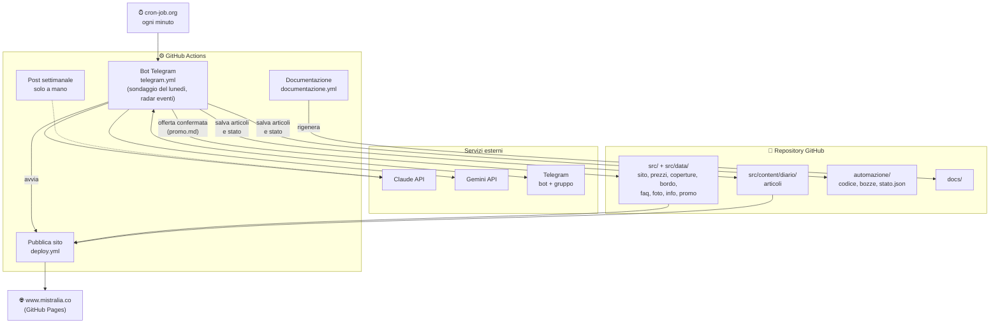
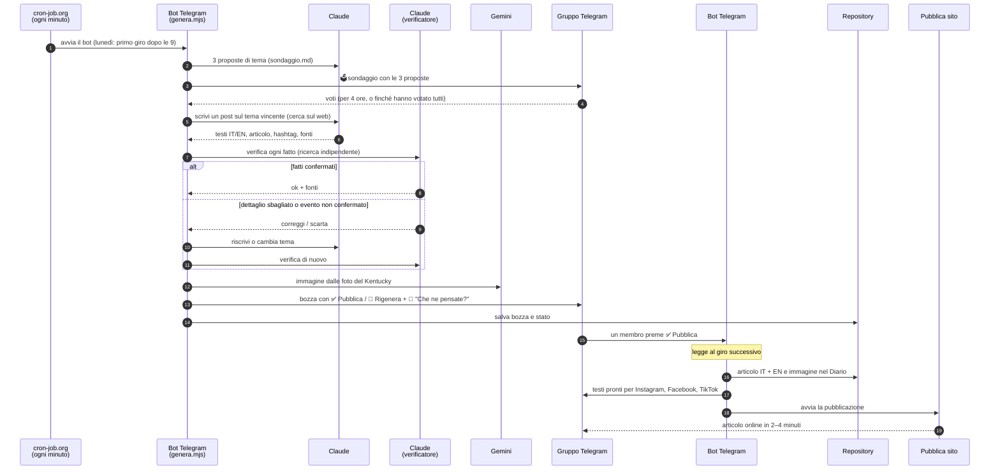
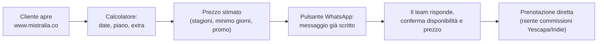
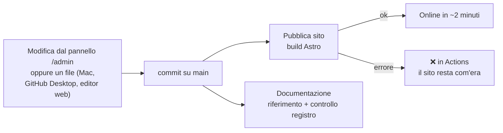

# Architettura

[← Indice](README.md)

Il sistema non ha server da tenere accesi né database. Il sito è statico e i programmi girano su GitHub solo quando servono. Tutto quello che conta, compresi i prezzi, gli articoli e lo stato del bot, è salvato come file nel repository, quindi ogni modifica ha una storia e si può annullare.

## I pezzi

| Pezzo | Cosa fa | Dove sta | Costo |
| --- | --- | --- | --- |
| **Sito** | Pagina unica bilingue (italiano su `/`, inglese su `/en/`) con prezzi, calcolatore, foto, Diario, contatti | `src/`, costruito con [Astro](https://astro.build) | gratis |
| **GitHub Pages** | Pubblica il sito sul dominio `www.mistralia.co` | impostazioni del repository → Pages | gratis |
| **Pubblica sito** | Ricostruisce il sito e lo mette online | `.github/workflows/deploy.yml` | gratis |
| **Post settimanale** | Prepara subito una bozza, **solo se avviato a mano** (la bozza del lunedì la prepara il bot) | `.github/workflows/post-settimanale.yml` → `automazione/genera.mjs` | Claude + Gemini a consumo |
| **Bot Telegram** | Legge tap, risposte e voti nel gruppo ed esegue: pubblica, rigenera, corregge. **Il lunedì dalle 9 manda il sondaggio sul tema della settimana** e dopo il voto prepara la bozza. **Martedì e venerdì dalle 11 il radar eventi** propone 2–3 eventi, anche con un'offerta da attivare sul sito | `.github/workflows/telegram.yml` → `automazione/telegram.mjs` → `genera.mjs`, `sondaggio.mjs`, `radar.mjs` | gratis (costano solo le chiamate a Claude e Gemini) |
| **Sveglia (cron-job.org)** | Ogni minuto chiede a GitHub di avviare il Bot Telegram | cron-job.org, account di Gianluca | gratis |
| **Documentazione** | Rigenera il [riferimento tecnico](riferimento.md) e controlla che il [registro](registro-modifiche.md) sia aggiornato | `.github/workflows/documentazione.yml` → `automazione/documentazione.mjs` | gratis |
| **Claude** | Scrive testi e articoli, cerca sul web, **verifica i fatti** in una seconda chiamata indipendente | API Anthropic, modello in `automazione/config.json` | ~$2 / milione di token + $0,01 a ricerca |
| **Gemini** | Crea l'immagine partendo dalle foto vere del Kentucky | API Google, modello in `config.json` | ~$0,07 a immagine |
| **Telegram** | Gruppo "Mistralia" + bot: anteprime e approvazioni | app Telegram | gratis |
| **Pannello `/admin`** | Moduli per modificare i dati del sito; ogni Salva è un commit | `public/admin/` ([Sveltia CMS](https://sveltiacms.app)) | gratis |
| **WhatsApp** | Il cliente invia la richiesta di preventivo già compilata dal calcolatore | numero in `src/data/info.json` | gratis |

GitHub Actions è gratuito senza limiti di minuti perché il repository è **pubblico**. Attenzione: pubblico vuol dire che **chiunque può leggere** i file del repository, comprese le bozze non pubblicate. Le chiavi invece no: stanno nei Secrets. Vedi [Sicurezza](05-sicurezza.md#repository-pubblico).

## Flusso 1: il post della settimana

La stessa bozza può partire anche da uno **spunto del radar eventi** (✍️ Prepara la bozza, o 🏷 Post + offerta dopo aver attivato l'offerta sul sito) o dal comando `/nuovo`. Il dettaglio di ogni passo è in [Automazione](04-automazione.md).

## Flusso 2: un cliente prenota

Il sito **non** prende pagamenti e **non** blocca date in automatico. La disponibilità la conferma una persona su WhatsApp, e il calendario delle date occupate sul sito si aggiorna a mano: vedi [Il sito](03-sito.md#calendario).

## Flusso 3: una modifica al sito

Le modifiche alla sola cartella `automazione/`, a `docs/` e ai file README non avviano *Pubblica sito*, perché non cambiano le pagine.

## Dove vivono i dati

| Dato | File | Chi lo cambia |
| --- | --- | --- |
| Prezzi, stagioni, minimi, km | `src/data/prezzi.json` | Gianluca, dal pannello `/admin` |
| Piani, quota, extra | `src/data/coperture.json` | Gianluca, dal pannello |
| Kit, preparazione, riconsegna, regole | `src/data/bordo.json` | Gianluca, dal pannello |
| Domande frequenti | `src/data/faq.json` | Gianluca, dal pannello |
| Foto di apertura e galleria | `src/data/foto.json` | Gianluca, dal pannello |
| Contatti, ritiro, calendario, azienda | `src/data/info.json` | Gianluca, dal pannello |
| Promo del momento | `src/data/promo.md` | Gianluca, dal pannello `/admin`; oppure il bot, dopo la conferma nel gruppo (radar → Post + offerta) |
| Testi fissi del sito | `src/i18n/it.json`, `src/i18n/en.json` | il team (a mano) |
| Articoli del Diario (con il tipo: offerta, evento, idea) | `src/content/diario/*.it.md` / `*.en.md` | il bot, con ✅ Pubblica; correzioni dal pannello |
| Immagini degli articoli | `public/assets/diario/` | il bot |
| Foto della galleria | `public/assets/gallery/` | Gianluca, dal pannello `/admin` |
| Bozze (anche quelle scartate) | `automazione/bozze/<data-tema>/` | il bot |
| Memoria del bot | `automazione/stato.json` | il bot (**non modificare a mano**) |
| Istruzioni a Claude | `automazione/prompt.md`, `automazione/verifica.md` | chi gestisce il tono e le regole |
| Impostazioni dell'automazione | `automazione/config.json` | chi gestisce costi e modelli |
| Chiavi e token | GitHub → Settings → Secrets | solo l'amministratore |

## Account e servizi esterni

Il titolare e l'unico riferimento di **tutti** gli account qui sotto è **Gianluca**.

| Servizio | A cosa serve | Note |
| --- | --- | --- |
| GitHub (`mistraliagianluca`) | Repository, Actions, Pages | 2FA obbligatoria. È l'account più importante: chi lo controlla controlla il sito |
| Anthropic Console (organizzazione *Mistralia srls*) | Chiave Claude, credito, limiti di spesa | console.anthropic.com |
| Google AI Studio / Google Cloud | Chiave Gemini, fatturazione | aistudio.google.com; budget in Google Cloud → Billing |
| Telegram | Bot (creato con @BotFather) e gruppo "Mistralia" | il proprietario del bot è chi l'ha creato con BotFather |
| cron-job.org | Sveglia del bot: lo avvia ogni minuto | attivo dal 22/11/2026; vedi [Automazione](04-automazione.md#la-sveglia-del-bot) |
| Registrar del dominio `mistralia.co` | DNS verso GitHub Pages | accesso: Gianluca |

L'elenco completo delle chiavi è in [Sicurezza](05-sicurezza.md).
