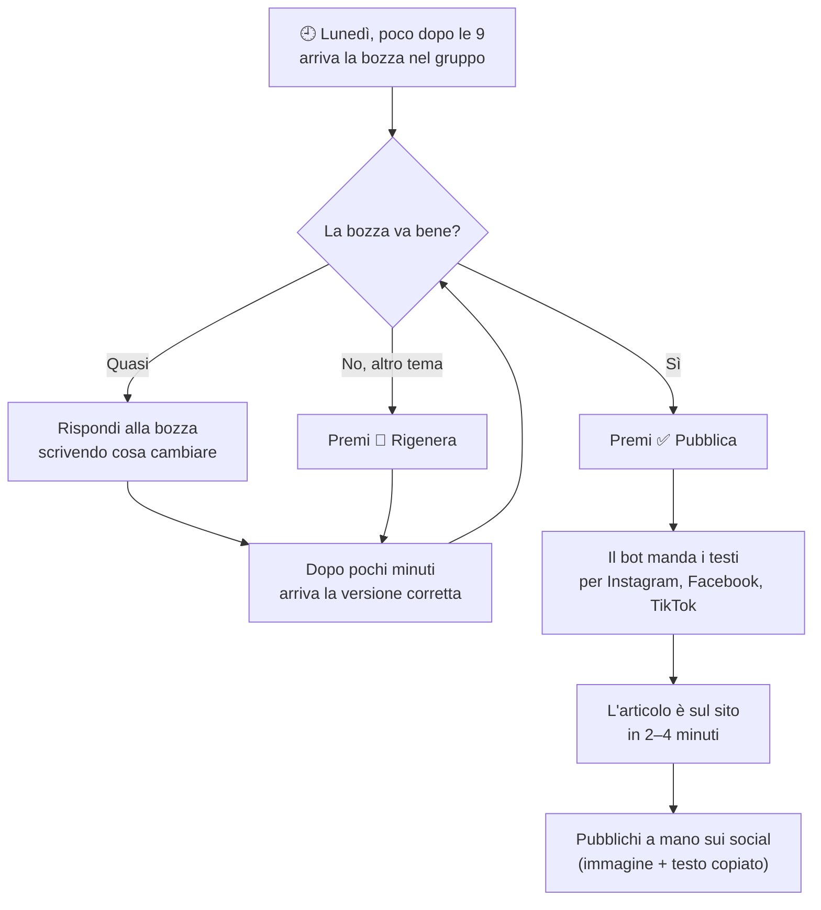

# Uso quotidiano: il bot Telegram

[← Indice](README.md)

Questa pagina è per **tutti i membri del gruppo Telegram "Mistralia"**, anche senza competenze tecniche. Non serve GitHub: si fa tutto dal telefono.

## La settimana tipo



Il tempo richiesto è circa **10–15 minuti a settimana**: leggere la bozza, un tap e la pubblicazione sui social.

## Com'è fatta una bozza

La bozza arriva come **foto con didascalia**. Se il testo è troppo lungo per la didascalia, arriva in un secondo messaggio subito sotto.

```
📝 Bozza della settimana              ← ⚠️ al posto di 📝 se la verifica dei fatti non è passata
«Titolo dell'articolo»
🗓 weekend lungo (3–4 giorni)         ← durata consigliata del viaggio

Testo del post per Instagram/Facebook…

#hashtag #hashtag …

🔎 Fatti verificati su: comune.esempio.it, …   ← fonti trovate dal verificatore
https://…

💰 Costo di questa bozza: circa $0.40 · nel mese: $1.20 su $8

Per correggere: rispondi a questo messaggio scrivendo cosa cambiare.
[ ✅ Pubblica ]  [ 🔄 Rigenera ]
```

### Prima di premere Pubblica, controlla:

- [ ] Il **luogo** esiste ed è raggiungibile come scritto (tempo da Bari, traghetto se c'è).
- [ ] Le **date** dell'evento, se ci sono. Il verificatore le ha già cercate, ma con un tap sulle fonti controlli in 30 secondi.
- [ ] L'**immagine** sembra il Kentucky e non ha scritte strane.
- [ ] Il **tono** è quello di Mistralia: fresco, niente promesse esagerate.

**Se la bozza inizia con ⚠️**, il verificatore non è riuscito a confermare qualcosa e sotto trovi l'elenco dei problemi. **Non pubblicarla**: premi 🔄 Rigenera oppure rispondi con una correzione.

## I comandi

| Azione | Come | Cosa succede | Costa? |
| --- | --- | --- | --- |
| **✅ Pubblica** | Tap sul pulsante | L'articolo (IT + EN) va nel Diario del sito; il messaggio diventa *"✅ Pubblicato da [nome]"*; arrivano i testi per i social | No |
| **🔄 Rigenera** | Tap sul pulsante | Il bot scrive *"🔄 [nome] ha chiesto un'altra proposta"* e prepara una bozza su **un altro tema e un altro luogo** | Sì, come una bozza |
| **Correggere** | Tieni premuto il messaggio della bozza (la foto **o** il testo sotto) → **Rispondi** → scrivi cosa cambiare → invio | Il bot scrive *"Ricevuto, preparo la versione corretta…"*; arriva la stessa bozza corretta, verificata di nuovo | Sì, come una bozza |
| `/nuovo` | Scrivi nel gruppo | Prepara subito una bozza, senza aspettare il lunedì | Sì |
| `/aiuto` | Scrivi nel gruppo | Mostra l'elenco dei comandi | No |
| `/id` | Scrivi nel gruppo | Mostra l'identificativo della chat (serve solo in fase di installazione) | No |

Esempi di correzioni che funzionano bene:
- *"tono più ironico, meno emoji"*
- *"aggiungi un consiglio su dove sostare a Matera"*
- *"rifai l'immagine: camper al tramonto"* (l'immagine viene rifatta solo se la correzione parla dell'immagine)
- *"togli l'evento, parla solo del borgo"*

### Regole importanti

1. **Un messaggio scritto senza "Rispondi" viene ignorato.** Così nel gruppo potete parlare tra voi liberamente.
2. **Il bot non risponde all'istante.** Viene svegliato ogni minuto: tra il tap e la risposta passano di solito **1–2 minuti**, più 2–5 minuti se deve preparare una bozza. Il motivo è spiegato in [Automazione → La sveglia del bot](04-automazione.md#la-sveglia-del-bot).
3. **Non premere due volte.** Se il bot non ha ancora risposto, aspetta: un secondo tap su Rigenera fa preparare (e pagare) due bozze.
4. **Chiunque nel gruppo può pubblicare.** Fate entrare nel gruppo solo persone del team.
5. Se una bozza resta senza risposta per **48 ore**, il bot manda un promemoria ⏰.
6. Quando arriva una bozza nuova, i pulsanti di quella vecchia spariscono: vale sempre e solo l'ultima.

## Pubblicare sui social (a mano, per ora)

Dopo ✅ Pubblica il bot manda due messaggi da copiare:
- **📋 Testo per Instagram e Facebook**: italiano, poi inglese, poi hashtag
- **📋 Testo per TikTok**: corto, con hashtag

**Instagram e Facebook:**
1. Sulla bozza, tieni premuta l'immagine → **Salva** nella galleria del telefono.
2. Tieni premuto il messaggio *"📋 Testo per Instagram e Facebook"* → **Copia**.
3. Apri Instagram → **+** → scegli l'immagine → incolla il testo → **Condividi**. Se gli account sono collegati, attiva *"Condividi anche su Facebook"*.

**TikTok:**
1. Usa la stessa immagine, oppure un breve video del camper.
2. Copia il *"📋 Testo per TikTok"* e incollalo nella descrizione.

Il link al sito va **nella bio** dei profili: i post dicono *"prenota dal link in bio"*. La pubblicazione automatica su Instagram e Facebook arriverà quando ci saranno gli account Meta aziendali.

## Le richieste dei clienti (WhatsApp)

Dal sito il cliente preme il pulsante WhatsApp e arriva un messaggio già compilato con date, piano, persone, extra, prezzo stimato, nome e note, in italiano o in inglese.

1. Controlla la **disponibilità** sul calendario interno (Yescapa, Indie e prenotazioni dirette).
2. Il prezzo è **stimato**: confermalo, o correggilo se ci sono promo particolari o eccezioni.
3. Quando la prenotazione è confermata, **segna le date** nel Google Calendar "Mistralia – occupato", così il sito le mostra come occupate.

## Cosa fare se…

| Succede che… | Fai così |
| --- | --- |
| Il lunedì dopo le 9:15 non è arrivata la bozza | Se nel gruppo c'è un ⚠️, leggilo; poi scrivi `/nuovo`. Se dopo 10 minuti non è successo niente, avvisa Gianluca |
| Arriva *"⚠️ Qualcosa non è andato: …"* | Copia il messaggio e mandalo a Gianluca. Non riprovare più volte di seguito |
| Arriva *"⚠️ … budget del mese raggiunto"* | Il tetto di spesa mensile è stato superato: fino al mese dopo niente bozze nuove. Decide l'amministratore se alzarlo |
| Ho pubblicato per sbaglio | Avvisa Gianluca: dal pannello `/admin` → *Diario* lo nasconde in 2 minuti |
| Un evento è passato | Non serve fare niente: dal giorno dopo la fine dell'evento l'articolo esce dalla home e la sua pagina dice "evento concluso". I post social restano (è normale) |
| Il post contiene un errore già pubblicato | Come sopra; per i social, modifica o cancella il post dall'app |
| Il bot non risponde da più di 10 minuti | Avvisa Gianluca: controllerà la cronologia di cron-job.org e Actions |
