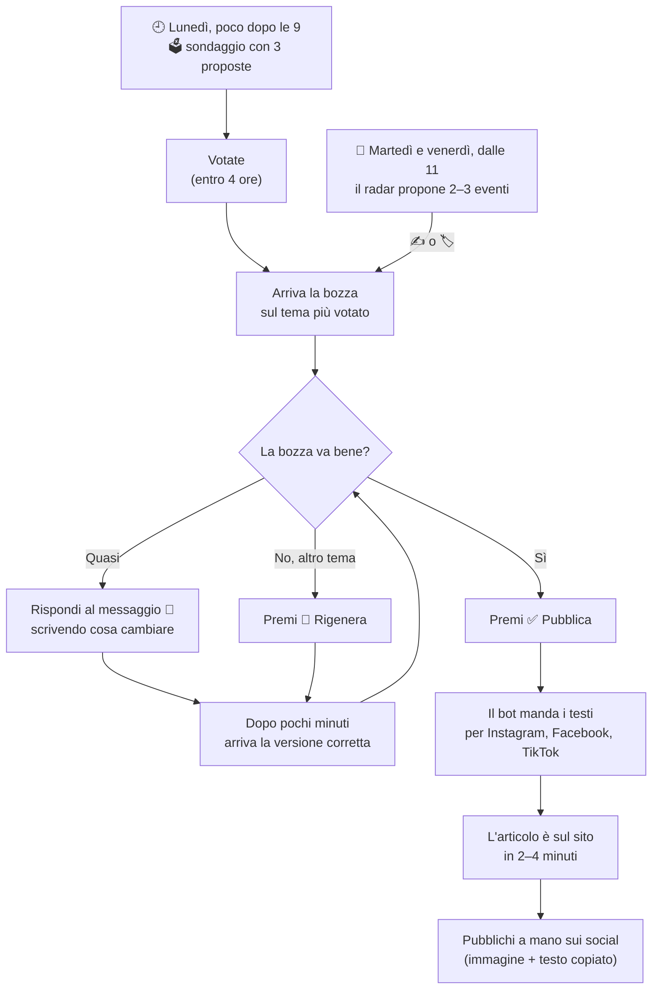

# Uso quotidiano: il bot Telegram

[← Indice](README.md)

Questa pagina è per **tutti i membri del gruppo Telegram "Mistralia"**, anche senza competenze tecniche. Non serve GitHub: si fa tutto dal telefono.

## La settimana tipo



Il tempo richiesto è circa **10–15 minuti a settimana**: un voto, leggere la bozza, un tap e la pubblicazione sui social. Gli spunti del radar sono facoltativi: se non vi interessano, ⏭ No.

## Il sondaggio del lunedì

Il lunedì dalle 9 il bot non manda più subito una bozza: prima chiede **su cosa fare il post**, con un sondaggio Telegram e 3 proposte (per esempio un evento, un borgo di stagione, un itinerario). Sotto il sondaggio c'è un messaggio con i dettagli di ogni proposta e le fonti.

- **Votate** toccando una proposta. Il sondaggio resta aperto **4 ore**, oppure si chiude prima se hanno votato tutti i membri del gruppo.
- Alla chiusura il bot scrive *"🗳 Ha vinto «…»"* e dopo qualche minuto arriva la bozza su quel tema.
- **Pareggio o nessun voto:** vince la prima proposta, quella che il bot consiglia.
- Per farne uno subito (es. se lunedì non c'eravate): `/sondaggio`.

## Il radar eventi

Il **martedì e il venerdì dalle 11** il bot cerca eventi delle prossime 2–8 settimane (concerti, mostre, festival, teatro, sagre, sport, fiere…) nelle mete raggiungibili da Bari e ne propone 2–3, **uno per messaggio**:

```
🎵 Spunto 1/3
«Nome dell'evento» · Matera
🗓 12–14 dicembre 2026 · 🚐 circa 1 ora di auto
Perché vale il viaggio, in una frase.
🔗 sito ufficiale dell'evento
🏷 Idea offerta: −10% sui noleggi dal 10 al 14 dicembre

Facciamo un post?
[ ✍️ Prepara la bozza ] [ 🏷 Post + offerta ]
[ ⏭ No, grazie ]
```

| Scelta | Cosa succede |
| --- | --- |
| **✍️ Prepara la bozza** | Dopo qualche minuto arriva la bozza su quell'evento (verificata come sempre) |
| **Rispondi allo spunto** con delle indicazioni (es. *"sì, ma punta sul mercatino"*) | Come ✍️, tenendo conto di quello che hai scritto |
| **🏷 Post + offerta** (solo se c'è un'idea di offerta) | Arriva la **proposta di offerta**: sconto, date dei noleggi, testo e date del banner. Vedi sotto |
| **⏭ No, grazie** | Lo spunto si chiude e non viene più riproposto. Non costa niente |

**La proposta di offerta** chiede sempre: *"❓ Il camper è libero in quei giorni?"*. **Controllate il calendario prima di confermare.** Se c'è già una promo attiva, il bot avvisa che verrà sostituita.

| Scelta | Cosa succede |
| --- | --- |
| **✅ È libero: attiva l'offerta** | La promo va sul sito (banner, sconto nel calcolatore) in circa 3 minuti, e arriva la bozza del post che la cita. Quando pubblicate l'articolo, è di tipo **🏷 Offerta** e resta **in evidenza in cima al Diario** finché c'è il banner |
| **Rispondi alla proposta** (es. *"15% e noleggi dal 6 al 10"*, *"banner fino al 5"*) | Il bot rifà la proposta con le modifiche e chiede di nuovo conferma |
| **📝 Solo il post** | Bozza sull'evento, senza offerta |
| **❌ Annulla** | Niente post e niente offerta |

L'offerta attivata dal bot si cambia o si spegne dal pannello → *Promozione*, come tutte. Per cercare eventi subito: `/radar`.

## Com'è fatta una bozza

La bozza arriva come **foto con didascalia**. Se il testo è troppo lungo per la didascalia, arriva in un secondo messaggio subito sotto.

```
📝 Bozza · 📅 Evento                  ← ⚠️ al posto di 📝 se la verifica non è passata; tipo: 🏷 Offerta, 📅 Evento, 🧭 Idea di viaggio
«Titolo dell'articolo»
🗓 weekend lungo (3–4 giorni)         ← durata consigliata del viaggio

Testo del post per Instagram/Facebook…

#hashtag #hashtag …

🔎 Fatti verificati su: comune.esempio.it, …   ← fonti trovate dal verificatore
https://…

💰 Costo di questa bozza: circa $0.40 · nel mese: $1.20 su $15

Per correggere: rispondi al messaggio 💬 qui sotto.
[ ✅ Pubblica ]  [ 🔄 Rigenera ]
```

Subito sotto arriva il **messaggio di dialogo**:

```
💬 Che ne pensate?
Rispondete a questo messaggio per chiedere modifiche (es. "tono più ironico", "rifai l'immagine al tramonto").

Prima di pubblicare controllate:
• le date 12–13 dicembre → comune.agnone.is.it     ← scritte dal verificatore, per questa bozza
• che nell'immagine il camper sia il Kentucky e non ci siano scritte strane
```

È **lì** che si risponde per correggere (funziona anche rispondere alla foto o al testo).

### Prima di premere Pubblica, controlla:

- [ ] Il **luogo** esiste ed è raggiungibile come scritto (tempo da Bari, traghetto se c'è).
- [ ] I punti elencati nel messaggio 💬 (date, traghetto, ecc.): il verificatore li ha già cercati, ma con un tap sulle fonti controlli in 30 secondi.
- [ ] L'**immagine** sembra il Kentucky e non ha scritte strane.
- [ ] Il **tono** è quello di Mistralia: fresco, niente promesse esagerate.

**Se la bozza inizia con ⚠️**, il verificatore non è riuscito a confermare qualcosa e sotto trovi l'elenco dei problemi. **Non pubblicarla**: premi 🔄 Rigenera oppure rispondi con una correzione.

## I comandi

| Azione | Come | Cosa succede | Costa? |
| --- | --- | --- | --- |
| **✅ Pubblica** | Tap sul pulsante | L'articolo (IT + EN) va nel Diario del sito; il messaggio diventa *"✅ Pubblicato da [nome]"*; arrivano i testi per i social | No |
| **🔄 Rigenera** | Tap sul pulsante | Il bot scrive *"🔄 [nome] ha chiesto un'altra proposta"* e prepara una bozza su **un altro tema e un altro luogo** | Sì, come una bozza |
| **Correggere** | Tieni premuto il messaggio **💬 Che ne pensate?** (oppure la foto o il testo della bozza) → **Rispondi** → scrivi cosa cambiare → invio | Il bot scrive *"Ricevuto, preparo la versione corretta…"*; arriva la stessa bozza corretta, verificata di nuovo | Sì, come una bozza |
| `/nuovo` | Scrivi nel gruppo | Prepara subito una bozza, senza aspettare il lunedì | Sì |
| `/nuovo` + indicazioni | Es. `/nuovo un weekend a Matera per l'Immacolata` | Bozza nuova che segue le tue indicazioni | Sì |
| `/sondaggio` | Scrivi nel gruppo | Sondaggio con 3 proposte, poi la bozza sul più votato | Sì, poco (~$0,20) più la bozza |
| `/radar` | Scrivi nel gruppo | Cerca subito eventi e li propone (vedi [Il radar eventi](#il-radar-eventi)) | Sì (~$0,30–0,50) |
| **Pulsanti degli spunti** | ✍️ · 🏷 · ⏭ | Vedi [Il radar eventi](#il-radar-eventi) | ✍️ e 🏷 come una bozza; ⏭ no |
| `/aiuto` | Scrivi nel gruppo | Mostra l'elenco dei comandi | No |
| `/id` | Scrivi nel gruppo | Mostra l'identificativo della chat (serve solo in fase di installazione) | No |

Esempi di correzioni che funzionano bene:
- *"tono più ironico, meno emoji"*
- *"aggiungi cosa vedere nei Sassi la sera"*
- *"rifai l'immagine: camper al tramonto"* (l'immagine viene rifatta solo se la correzione parla dell'immagine)
- *"togli l'evento, parla solo del borgo"*

### Regole importanti

1. **Un messaggio scritto senza "Rispondi" viene ignorato.** Così nel gruppo potete parlare tra voi liberamente. Il bot reagisce solo alle risposte al messaggio 💬 (o alla bozza), agli spunti del radar e alla proposta di offerta.
   I post non indicano **mai dove dormire o sostare**: è una regola dell'azienda, non chiedetelo nelle correzioni.
2. **Il bot non risponde all'istante.** Viene svegliato ogni minuto: tra il tap e la risposta passano di solito **1–2 minuti**, più 2–5 minuti se deve preparare una bozza. Il motivo è spiegato in [Automazione → La sveglia del bot](04-automazione.md#la-sveglia-del-bot).
3. **Non premere due volte.** Se il bot non ha ancora risposto, aspetta: un secondo tap su Rigenera fa preparare (e pagare) due bozze.
4. **Chiunque nel gruppo può pubblicare.** Fate entrare nel gruppo solo persone del team.
5. Se una bozza resta senza risposta per **48 ore**, il bot manda un promemoria ⏰.
6. Quando arriva una bozza nuova, i pulsanti di quella vecchia spariscono: vale sempre e solo l'ultima.

## Pubblicare sui social (a mano, per ora)

Dopo ✅ Pubblica il bot manda due messaggi da copiare:
- **📋 Testo per Instagram e Facebook**: italiano, poi inglese, poi hashtag
- **📋 Testo per TikTok**: corto, con hashtag

Entrambi finiscono con la nota *"📸 Ambientazione creata con l'AI, il camper è quello vero."* (nel testo per Instagram e Facebook anche in inglese): lasciala, perché è corretto dirlo e protegge da contestazioni. Sul sito la stessa nota compare sotto l'immagine dell'articolo.

**Instagram e Facebook:**
1. Sulla bozza, tieni premuta l'immagine → **Salva** nella galleria del telefono.
2. Tieni premuto il messaggio *"📋 Testo per Instagram e Facebook"* → **Copia**.
3. Apri Instagram → **+** → scegli l'immagine → incolla il testo → **Condividi**. Se gli account sono collegati, attiva *"Condividi anche su Facebook"*.

**TikTok:**
1. Usa la stessa immagine, oppure un breve video del camper.
2. Copia il *"📋 Testo per TikTok"* e incollalo nella descrizione.

Il link al sito va **nella bio** dei profili: i post dicono *"prenota dal link in bio"*. La pubblicazione automatica su Instagram e Facebook arriverà quando ci saranno gli account Meta aziendali.

## Le richieste dei clienti (WhatsApp)

Dal sito il cliente preme il pulsante WhatsApp e arriva un messaggio già compilato con date, piano, persone, extra, prezzo stimato, nome e note, in italiano o in inglese.

1. Controlla la **disponibilità** sul calendario interno (Yescapa, Indie e prenotazioni dirette).
2. Il prezzo è **stimato**: confermalo, o correggilo se ci sono promo particolari o eccezioni.
3. Quando la prenotazione è confermata, **segna le date** nel Google Calendar "Mistralia – occupato", così il sito le mostra come occupate.

## Cosa fare se…

| Succede che… | Fai così |
| --- | --- |
| Il lunedì dopo le 9:15 non è arrivato il sondaggio | Se nel gruppo c'è un ⚠️, leggilo; poi scrivi `/sondaggio` (o `/nuovo` per una bozza diretta). Se dopo 10 minuti non è successo niente, avvisa Gianluca |
| Il sondaggio è chiuso ma la bozza non arriva | Aspetta 5–10 minuti. Se arriva un ⚠️, scrivi `/nuovo` con il tema vincente (es. `/nuovo mercatini di Natale a Matera`) |
| Abbiamo attivato un'offerta per sbaglio | Pannello → *Promozione* → spegni *Promo attiva* → Save. Sul sito sparisce in circa 2 minuti |
| Arriva *"⚠️ Qualcosa non è andato: …"* | Copia il messaggio e mandalo a Gianluca. Non riprovare più volte di seguito |
| Arriva *"⚠️ … budget del mese raggiunto"* | Il tetto di spesa mensile è stato superato: fino al mese dopo niente bozze nuove. Decide l'amministratore se alzarlo |
| Ho pubblicato per sbaglio | Avvisa Gianluca: dal pannello `/admin` → *Diario* lo elimina (articolo sbagliato) o lo archivia (non più adatto), online in 2 minuti |
| Nel gruppo arriva *"🌍 Versione inglese aggiornata"* | Normale: qualcuno ha modificato un articolo in italiano e il bot ha aggiornato la traduzione |
| In home non vedo un articolo attivo | La home mostra l'offerta in evidenza e gli ultimi 6: gli altri sono in *Tutti gli articoli* e nella pagina Diario del menu |
| Un evento o un'offerta è passato | Non serve fare niente: dal giorno dopo la fine l'articolo esce dalla home, va nell'*Archivio* della pagina Diario e la sua pagina dice "evento concluso" (o "offerta terminata"). I post social restano (è normale) |
| Il post contiene un errore già pubblicato | Come sopra; per i social, modifica o cancella il post dall'app |
| Il bot non risponde da più di 10 minuti | Avvisa Gianluca: controllerà la cronologia di cron-job.org e Actions |
