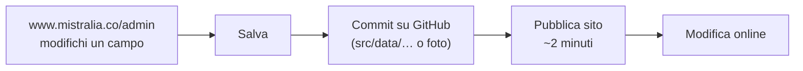
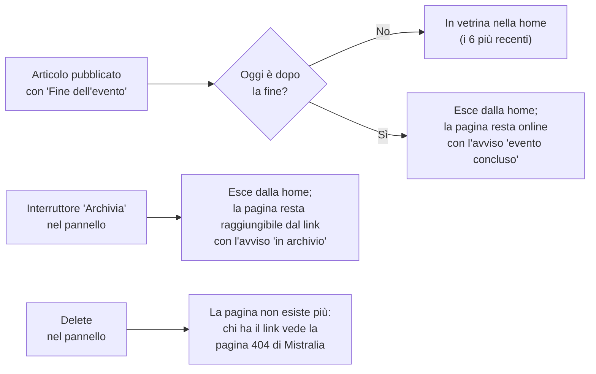
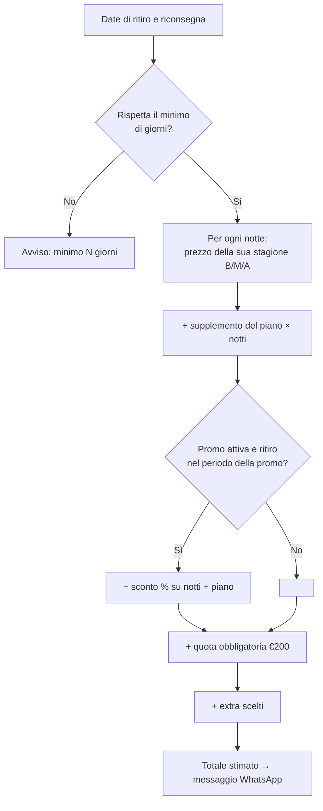

# Il sito www.mistralia.co

[← Indice](README.md)

Il sito è **una pagina sola**, in italiano (`www.mistralia.co/`) e in inglese (`www.mistralia.co/en/`). I visitatori con il browser in una lingua diversa dall'italiano vengono portati da soli alla versione inglese. In più ci sono le pagine degli articoli del Diario: `/diario/<chiave>/` in italiano e `/en/journal/<chiave>/` in inglese.

## Le sezioni della pagina (dall'alto)

La pagina è pensata **prima per il telefono**: niente scorrimento laterale (regola fissa del progetto), sezioni basse, testi brevi. Su telefono è alta circa 6.900 pixel (prima del 22/11/2026 erano 11.900).

| Sezione | Cosa mostra | Da dove prende i dati |
| --- | --- | --- |
| **Banner promo** | Barra gialla in cima, **dentro l'intestazione fissa**: resta visibile anche scorrendo. Solo se la promo è attiva e nelle date giuste | `promo.md` |
| **Apertura** | Logo, foto di apertura (senza scritte sopra), titolo, pulsante *Calcola il prezzo*, "da €X al giorno" e il riquadro **"A bordo c'è già tutto"** con 4 icone (pieno, cucina per 4, kit sosta libera, assistenza 24/7) che porta al kit | `foto.json` → `fotoApertura`; prezzo più basso da `prezzi.json` |
| **Perché il Kentucky** | Tre righe con icona | testi in `src/i18n/` (`why_*`) |
| **Diario di bordo** | In cima, se la promo è visibile, l'**articolo dell'offerta** in evidenza (più grande, bordo giallo, testo del banner). Sotto, i **6 articoli più recenti** non scaduti: su telefono righe compatte (miniatura, tipo, data, titolo), su computer una griglia 3×2 con immagine ed estratto. Ogni articolo ha il suo tipo: 🏷 Offerta, 📅 Evento, 🧭 Idea di viaggio. Se gli articoli attivi sono di più, il pulsante **Tutti gli articoli (N)** porta alla pagina Diario. È in alto apposta, perché più in basso nessuno ci arrivava | `src/content/diario/`, `promo.md` |
| **Pagina Diario** (`/diario/`, `/en/journal/`) | Tutti gli articoli attivi dal più recente, e sotto l'**Archivio** con gli eventi conclusi. Ci porta la voce *Diario* del menu, che compare quando c'è almeno un articolo | `src/components/DiarioIndice.astro` |
| **Kit di partenza** | Elenco con icone (2–4 colonne su schermo grande), la nota *"Lenzuola e asciugamani non sono inclusi: puoi aggiungerli tra gli extra"* e il riquadro *Prima di ogni partenza* | `bordo.json` → `kit` (campo `icona` facoltativo: se manca, l'icona dipende dalla posizione del gruppo), `preparazione` |
| **Piani e prezzi** | 1 · stagioni (tre riquadri con prezzo e periodi) · 2 · coperture (tre colonne, senza tabelle larghe) · 3 · quota fissa: **è l'unico posto in cui compare la quota da €200** · extra in una riga | `prezzi.json`, `coperture.json` |
| **Calcolatore** | Date affiancate anche su telefono, piano, persone (menu alto quanto gli altri campi, numero al centro), extra, note, totale e *Invia la richiesta su WhatsApp*. Sotto, il calendario delle date occupate (apribile), **solo se è configurato**. Con la promo visibile, il riquadro giallo dello sconto ha il link **Leggi l'idea di viaggio →** all'articolo dell'offerta | `prezzi.json`, `coperture.json`, `promo.md`, `info.json` |
| **Galleria** | 2 foto su telefono, 3 su schermo grande, il pulsante *Tutte le foto (N)* e il pulsante verde **📷 Foto** nell'intestazione, sempre visibile anche su telefono. Sulla home tutti e due aprono direttamente il visore; dagli articoli il pulsante Foto porta alla galleria della home. Il visore è a tutto schermo, con frecce, tastiera, swipe e contatore | `foto.json` → `galleria` |
| **Ritiro e riconsegna** | Indirizzo con link a Maps, orari, come riconsegnarlo, regole | `info.json` → `ritiro`; `bordo.json` → `riconsegna`, `regole` |
| **Domande frequenti** | Domande apribili; quelle con `DA_CONFERMARE` sono nascoste | `faq.json` |
| **Contatti** | Telefoni ed email | `info.json` |
| **WhatsApp** | **Un solo pulsante**, fisso in basso a destra e sempre visibile su ogni schermo. L'unico altro pulsante WhatsApp è quello del calcolatore, che manda la richiesta già compilata | `info.json` → `whatsapp` |

**Messaggio "completo di tutto":** il sito e i post dicono che il camper è **completo di tutto per partire**, ma **non** usano formule come "tutto incluso" o "tutto incluso tranne le lenzuola": lenzuola e asciugamani sono extra a pagamento e sono indicati come tali nel kit, negli extra e nel calcolatore. Titolo per Google: *"Noleggio camper a Bari · pieno, kit e assistenza inclusi | Mistralia"* (`meta_title` in `src/i18n/`).

**Calcolatore, date:** appena si sceglie il ritiro, la riconsegna non può essere prima del giorno dopo e, se è vuota, viene proposta con il **noleggio minimo** di quel periodo, così il calendario si apre già dalla data giusta e il prezzo compare subito.

## Il pannello www.mistralia.co/admin

Il modo consigliato per cambiare **prezzi, stagioni, promo, contatti, kit, regole, FAQ e foto** è il pannello: moduli con campi, menu e calendari al posto dei file. Premi **Salva**, il pannello fa il commit su GitHub al posto tuo e *Pubblica sito* mette online la modifica in circa 2 minuti.



**Accesso (una volta per browser):**
1. Crea un token GitHub dedicato al pannello: github.com → foto profilo → **Settings → Developer settings → Personal access tokens → Fine-grained tokens → Generate new token**.
   - Name `pannello-admin`; Expiration 1 anno
   - Repository access: **Only select repositories** → `mistraliagianluca.github.io`
   - Permissions → Repository permissions → **Contents: Read and write** (Metadata si aggiunge da solo), nient'altro
   - Salvalo nel password manager e annotalo in [Sicurezza](05-sicurezza.md#inventario-dei-segreti).
2. Apri **www.mistralia.co/admin** → **Sign In Using Access Token** → incolla il token. Il browser lo ricorda: le volte successive entri direttamente.

**Com'è fatto (dal 23/11/2026):** a sinistra un elenco corto, una voce per argomento. Ogni voce apre **un solo modulo**, a tutta larghezza (senza l'anteprima affiancata). Gli elenchi lunghi (stagioni, extra, kit, regole, FAQ) sono **chiusi**: ogni riga mostra un riassunto (es. *"1 nov 2026 → 24 mar 2027 · Bassa"*, *"Che patente serve?"*) e si apre con un tocco su ›; *Expand All* le apre tutte.

| Voce del pannello | Cosa contiene | File |
| --- | --- | --- |
| 📖 **Diario** | Gli articoli (solo italiano) | `src/content/diario/*.it.md` |
| 💶 **Prezzi e stagioni** | Prezzo al giorno, calendario delle stagioni, noleggio minimo ed eccezioni, km | `src/data/prezzi.json` |
| 🛡 **Piani ed extra** | Piani Basic/Plus/Premium, quota obbligatoria, extra facoltativi | `src/data/coperture.json` |
| 🏷 **Promozione** | Banner, sconto e date | `src/data/promo.md` |
| ✅ **A bordo** | Kit (riquadri con icona), prima di ogni partenza, riconsegna, regole | `src/data/bordo.json` |
| ❓ **FAQ** | Domande frequenti: domanda e risposta in italiano e in inglese | `src/data/faq.json` |
| 🖼 **Foto** | Foto di apertura, foto di riserva, galleria | `src/data/foto.json` |
| ☎️ **Contatti** | WhatsApp, telefoni, email, ritiro, calendario, dati dell'azienda, GoatCounter | `src/data/info.json` |

Le icone vere del pannello sono simboli Material (`icon` in `config.yml`); le voci sono separate in tre gruppi da una linea: prezzi e promo, contenuti, contatti. Sveltia chiama *Files* il gruppo delle voci a file singolo.

**Uso:** scegli la voce → modifica → **Save** (in alto a destra). Le foto si caricano dalla voce *Foto* (anche dal telefono), si trascinano per cambiare l'ordine e finiscono in `public/assets/gallery/`. Il sito unisce i file in `src/lib/site.ts`: per i componenti è come se fossero un file solo.

**Diario (articoli):** voce *Diario* del pannello. Si vede e si modifica **solo la versione italiana**: titolo, **tipo di articolo** (🧭 Idea di viaggio, 📅 Evento, 🏷 Offerta), anteprima, testo, immagine, **Fine dell'evento o dell'offerta**, interruttore **Archivia** o **Delete**. La **versione inglese si aggiorna da sola** entro pochi minuti: il bot ritraduce i testi cambiati, copia date, immagine e interruttori, ed elimina l'inglese se elimini l'italiano. Nel gruppo Telegram arriva *"🌍 Versione inglese aggiornata"*. Gli articoli nuovi li crea solo il bot.

**Ordine dell'elenco:** in cima gli articoli **🟢 in vetrina**, sotto quelli **⚪ evento concluso** e **⚫ archiviato**, ognuno dal più recente. Lo stato lo aggiorna il bot entro 1–2 minuti da ogni modifica, e a mezzanotte per quelli che scadono. Il pannello ricorda l'ultimo ordinamento scelto con *Sort*: per tornare a questo scegli *Ordine*, decrescente.

**Cosa NON si cambia dal pannello:** i testi fissi del sito (`src/i18n/`), i nomi dei piani e le impostazioni dell'automazione. Per questi vedi la tabella qui sotto.

**Da sapere:**
- Il pannello è solo per Gianluca: per entrare serve un token con accesso in scrittura al repository. Chi apre `/admin` senza token vede solo la schermata di accesso, e la pagina non compare su Google (`noindex`).
- Ogni Salva è un commit visibile nella storia del repository, quindi si può sempre tornare indietro ([Sviluppo → Tornare indietro](06-sviluppo.md#tornare-indietro)).
- Se lavori anche dal Mac, fai `git pull` prima di modificare, perché il pannello cambia i file su GitHub.
- Il pannello è [Sveltia CMS](https://sveltiacms.app), gratuito e open source, caricato da unpkg.com. La configurazione dei campi è in `public/admin/config.yml`: se la cambi, aggiorna questa pagina e il registro delle modifiche.

## Cosa si modifica e dove

| Voglio cambiare… | File | Come |
| --- | --- | --- |
| **Prezzo al giorno** di una stagione | pannello → Prezzi e stagioni · oppure `src/data/prezzi.json` → `prezzoGiorno` | `B` bassa, `M` media, `A` alta |
| **In che stagione** è un giorno | pannello → Prezzi e stagioni → *Calendario delle stagioni* · oppure `prezzi.json` → `periodi` | Elenco di periodi `dal`–`al` con la stagione. I giorni non coperti valgono come media; un anno senza periodi usa quelli dell'ultimo anno presente. **Per un anno nuovo aggiungi i suoi periodi** |
| **Noleggio minimo** | pannello → Prezzi e stagioni · oppure `prezzi.json` → `minimoGiorni`, `minimoEccezioni` | Le eccezioni valgono per i ritiri tra `dal` e `al` |
| **Piani** (supplemento, cauzione, franchigia) | pannello → Piani ed extra · oppure `coperture.json` → `piani` | `supplementoGiorno` in euro al giorno |
| **Quota obbligatoria** (pulizia, preparazione, check-in) | pannello → Piani ed extra · oppure `coperture.json` → `servizio` | Si paga una volta per noleggio |
| **Extra** (lenzuola, asciugamani, barbecue, transfer) | pannello → Piani ed extra · oppure `coperture.json` → `extra` | Ogni extra ha un'**unità** (`unita`): *a noleggio*, *a persona* (il calcolatore moltiplica per le persone), *a letto* o *a tratta* (il calcolatore fa scegliere quanti letti o se andata e ritorno). Il nome va scritto senza l'unità: "a persona", "a letto" eccetera li aggiunge il sito |
| **Promo** (es. Black Friday) | pannello → Promozione · oppure `src/data/promo.md` | vedi [Promo](#promo) |
| **Numero WhatsApp**, telefoni, email | pannello → Contatti · oppure `src/data/info.json` | `whatsapp` senza `+` e senza spazi (es. `393756473839`) |
| **Indirizzo e orari di ritiro** | pannello → Contatti · oppure `info.json` → `ritiro` | È l'indirizzo che vedono i clienti, non la sede legale |
| **Kit incluso, preparazione, riconsegna, regole** | pannello → A bordo · oppure `bordo.json` | Sempre in italiano **e** inglese. Ogni gruppo del kit ha un'**icona** a scelta (carburante, benvenuto, sicurezza, energia, cucina, relax, igiene, comfort, spunta) |
| **Domande frequenti** | pannello → FAQ · oppure `faq.json` | Ogni domanda ha 4 campi: `domanda`, `risposta`, `question`, `answer`. Una risposta che contiene `DA_CONFERMARE` non viene mostrata |
| **Foto della galleria** | pannello → Foto · oppure `public/assets/gallery/` + `foto.json` → `galleria` | vedi [Foto](#foto) |
| **Testi fissi** (titoli, pulsanti, frasi) | `src/i18n/it.json` e `src/i18n/en.json` | Stesse chiavi in tutti e due i file |
| **Articoli del Diario** | pannello → Diario · oppure `src/content/diario/` | Li scrive il bot; vedi [Articoli scaduti, archiviati ed eliminati](#articoli-scaduti-archiviati-ed-eliminati) |
| Aspetto, colori, struttura | `src/components/`, `src/layouts/`, `src/styles/global.css` | Solo per chi sviluppa ([Sviluppo](06-sviluppo.md)) |

### In alternativa: modificare un file con l'editor web di GitHub

1. Apri `github.com/mistraliagianluca/mistraliagianluca.github.io` e vai al file, per esempio `src/data/prezzi.json`.
2. Premi l'icona della **matita ✏️** in alto a destra.
3. Cambia solo il valore. **Non togliere virgolette, virgole o parentesi**: in un file `.json` basta una virgola sbagliata per bloccare la pubblicazione.
4. Premi **Commit changes…** → scrivi cosa hai cambiato (es. *"Prezzo alta stagione 160"*) → **Commit changes**.
5. Vai in **Actions**: parte *Pubblica sito*. Se diventa verde, dopo circa 2 minuti la modifica è online.
6. Se diventa rossa ❌, il sito **resta com'era** e la tua modifica ha un errore di formato. Apri il file, correggilo oppure annulla la modifica (vedi [Sviluppo → Tornare indietro](06-sviluppo.md#tornare-indietro)).

Le modifiche a prezzi, promo, testi e foto **non** richiedono una riga nel registro delle modifiche: sono contenuti, non codice.

## Promo

Una sola promo alla volta. Nel pannello è la scheda **Promozione**; nel file `src/data/promo.md` i campi sono questi:

```yaml
attiva: false               # true = accesa, false = spenta subito
nome: "Black Friday"
sconto: 15                  # percentuale
mostra_dal: "2026-11-24"    # il banner compare da questo giorno…
mostra_al: "2026-12-01"     # …e sparisce da solo dopo questo
noleggi_dal: "2027-03-01"   # lo sconto vale solo per i noleggi che INIZIANO in questo periodo
noleggi_al: "2027-05-31"
titolo_it: "Black Friday: −15% sui noleggi di primavera"
titolo_en: "Black Friday: 15% off spring rentals"
```

- Lo sconto si applica **solo** a notti e piano, non alla quota obbligatoria né agli extra.
- Banner e riga dello sconto sono già nella pagina, nascosti: è il **browser del visitatore** a mostrarli solo tra *Banner visibile dal* e *fino al*. Compaiono e spariscono da soli a mezzanotte, senza bisogno di ricostruire il sito.
- Per vedere subito il banner (per esempio per una prova), metti come *Banner visibile dal* la data di oggi.
- Per una nuova promo cambia i valori e metti `attiva: true` (nel pannello: l'interruttore *Promo attiva*).
- Salvando dal pannello i commenti `#` del file spariscono: le spiegazioni restano qui e nei suggerimenti dei campi.
- **La promo la può attivare anche il bot**: dal radar eventi, con *🏷 Post + offerta* e la conferma *✅ È libero: attiva l'offerta* nel gruppo Telegram (vedi [Uso quotidiano → Radar eventi](02-uso-quotidiano.md#il-radar-eventi)). Il bot sovrascrive i valori della promo precedente, e lo dice prima della conferma.
- **Articolo dell'offerta:** se c'è un articolo di tipo *Offerta* con *Fine* uguale a *Banner visibile fino al* (il bot li fa così), finché il banner è visibile quell'articolo sta **in evidenza in cima al Diario** (home e pagina Diario) e il riquadro dello sconto nel calcolatore ha il link *Leggi l'idea di viaggio →*. Se manca, vale l'articolo *Offerta* più recente ancora valido all'inizio della promo; se non c'è nessun articolo *Offerta*, niente evidenza e niente link.

## Articoli scaduti, archiviati ed eliminati

**Regola:** nessun link porta a un vicolo cieco. Gli articoli conclusi o archiviati restano raggiungibili dal loro link, e quelli eliminati portano alla pagina "non c'è più" di Mistralia.



- **Tipo di articolo** (`categoria`): **🏷 Offerta** (post legato a una promo), **📅 Evento** (con date), **🧭 Idea di viaggio** (luoghi, borghi, itinerari). Lo sceglie il bot; si cambia dal pannello. Gli articoli di prima del 23/11/2026 non ce l'hanno: valgono come *Evento* se hanno una fine, altrimenti come *Idea*.
- **Fine dell'evento o dell'offerta** (`scadenza`): la scrive il bot quando il post parla di un evento con date (controllata dal verificatore) e, per le offerte, è l'ultimo giorno del banner della promo. Per luoghi e itinerari è vuota e l'articolo non scade. Si può correggere dal pannello.
- Dal giorno dopo la scadenza l'articolo **esce dalla home** e la sua pagina mostra *"Questo evento si è concluso il … · Scopri le prossime idee di viaggio"* (per le offerte: *"Questa offerta è terminata il …"*). La pagina **resta online** apposta, così i link già condivisi sui social non portano a una pagina inesistente. Lo decide il browser del visitatore in base alla data: non serve ricostruire il sito.
- La home mostra l'articolo dell'offerta in evidenza (se la promo è visibile) e i **6 articoli più recenti non scaduti**, più il pulsante *Tutti gli articoli (N)* se ce ne sono altri. Se sono tutti scaduti, la sezione Diario sparisce. La scheda dell'articolo è una sola (`src/components/PostCard.astro`) e cambia aspetto tra telefono e computer: niente da mantenere due volte.
- La **pagina Diario** (`/diario/`, in inglese `/en/journal/`) ha in alto i **filtri** *Tutti · Offerte · Eventi · Idee* (solo i tipi presenti), poi tutti gli articoli attivi (con l'offerta in evidenza) e, sotto, l'**Archivio** con eventi e offerte conclusi (anche questo lo decide il browser in base alla data). Il filtro resta nell'indirizzo: `/diario/#offerte`, `#eventi`, `#idee` si possono condividere. Il tipo nella pagina di un articolo porta alla pagina Diario già filtrata. Gli articoli **archiviati** con l'interruttore non compaiono né qui né in home: si raggiungono solo dal loro link.
- **Archivia** (`nascosto: true`, interruttore *Archivia* nel pannello): l'articolo **esce dalla home** ma la sua pagina **resta raggiungibile** da chi ha il link, ad esempio dai social, con l'avviso *"Questo articolo è in archivio e non è più in evidenza · Scopri le prossime idee di viaggio"*. Non compare in nessun elenco e Google non la indicizza (`noindex`). Si può riattivare spegnendo l'interruttore.
- **Elimina** (*Delete* nel pannello): per un articolo **sbagliato** da togliere davvero. Toglie l'articolo dal repository (resta nella storia di git), e il bot elimina anche la versione inglese. Chi apre il vecchio link vede la **pagina 404 di Mistralia**: *"Questa pagina non c'è più"*, con i pulsanti per il Diario, il calcolatore e WhatsApp, in italiano o in inglese secondo il link. L'immagine in `public/assets/diario/` resta e si può cancellare dalla libreria media del pannello.
- **Versione inglese:** non va mai modificata a mano, perché viene riscritta a ogni modifica dell'italiano. Si corregge l'italiano e la traduzione segue. Dettagli in [Automazione → Traduzioni](04-automazione.md#versione-inglese-degli-articoli).
- I **post social** non vengono toccati: è normale che i post di eventi passati restino sul profilo.

## Foto

- **Dal pannello:** campo *Galleria* → **carica** le foto o scegli tra quelle già caricate → trascina per l'ordine → Salva. Le foto finiscono in `public/assets/gallery/`. Usa foto orizzontali in JPG, meglio sotto i 500 KB.
- **Foto di apertura** (quella grande in alto): campo *Foto grande in cima* (`foto.json` → `fotoApertura`, oggi `/assets/gallery/SER.jpg`). Se il file non c'è, il sito usa la *Foto di riserva* (`fotoAperturaRiserva`). Maiuscole e minuscole nel nome del file non contano.
- **Foto sostituite con lo stesso nome:** il sito aggiunge a ogni immagine una versione calcolata dal contenuto del file (`7.jpg?v=3fa2c1d0`, funzione `versionata` in `src/lib/site.ts`). Quando una foto cambia, cambia l'indirizzo, e browser e GitHub Pages scaricano subito quella nuova invece di mostrare la copia in memoria. Vale per galleria, foto di apertura e immagini degli articoli.
- In `foto.json` la galleria è un elenco di percorsi (`"/assets/gallery/7.jpg"`). Per compatibilità il sito accetta anche il vecchio formato a numeri (`7`).
- **Riferimento del camper per i post:** Gemini usa le foto **vere** salvate in `automazione/riferimento/` (`kentucky-1.jpg`, `kentucky-2.jpg`), indicate in `automazione/config.json` → `fotoRiferimento`. Se mancano, usa `1.jpg` e `2.jpg` della galleria. Non cancellarle.
- Sotto la galleria c'è la nota *"Ambientazioni ricreate con l'intelligenza artificiale: il camper è quello vero."* (`gallery_ai_note` in `src/i18n/`).

### Rifare le foto della galleria con Gemini (una volta, dal Mac)

Il programma `automazione/foto-galleria.mjs` manda a Gemini ogni foto della galleria. Gli **esterni** vengono ambientati in Puglia (uliveto, costa di Polignano, trulli, masseria, Salento, Ostuni, Gargano, a rotazione) lasciando il camper identico; negli **interni** migliorano solo luce e colori. Le foto vengono **sovrascritte** con lo stesso nome e ridotte per il web con `sips` del Mac (lato lungo 1600 px, JPG qualità 80). La prima volta salva una copia di `1.jpg` e `2.jpg` in `automazione/riferimento/`.

```bash
cd ~/Documents/GitHub/mistraliagianluca.github.io
git pull --rebase
read -s GEMINI_API_KEY && export GEMINI_API_KEY   # incolla la chiave Gemini e premi invio: non si vede e non resta salvata
node automazione/foto-galleria.mjs                # tutte (circa 5 minuti, ~$1,50)
node automazione/foto-galleria.mjs 3 7            # solo alcune, per rifare quelle venute male
```

Prima del commit guarda le foto in `public/assets/gallery/`. Se una non va, **prima rimetti l'originale** con git (finché non hai fatto il commit), poi rifalla, così Gemini parte dalla foto vera e non dalla versione venuta male:

```bash
git checkout -- public/assets/gallery/6.jpg public/assets/gallery/7.jpg
node automazione/foto-galleria.mjs 6 7
```

Le istruzioni a Gemini chiedono anche che quello che si vede dai finestrini e dalle porte aperte sia coerente con il nuovo sfondo (negli interni niente paesaggio, che viene finto: fuori dai vetri solo luce del giorno chiara, come nelle foto professionali di interni). Poi `git add -A`, `git commit` e `git push`. Il comando costa circa $0,07 a foto, addebitati sulla fatturazione Google, e non entra nel tetto mensile del bot.

## Calendario

1. Su Google Calendar crea il calendario **"Mistralia – occupato"** e segna come eventi i giorni già venduti, **anche quelli presi da Yescapa o Indie**.
2. In *Impostazioni del calendario → Autorizzazioni di accesso* attiva **Rendi disponibile pubblicamente** con *Mostra solo disponibilità (nascondi dettagli)*.
3. In *Integra calendario* copia l'**URL dell'incorporamento** e incollalo nel pannello → *Contatti* → *Link "incorpora" del Google Calendar* (`info.json` → `calendarioEmbedUrl`).

Finché `calendarioEmbedUrl` è vuoto, sul sito **non compare niente** sulla disponibilità: né la voce *Disponibilità* nel menu, né il riquadro nel calcolatore. Quando incolli il link (anche dal pannello: *Contatti… → Link "incorpora" del Google Calendar*), compaiono tutti e due da soli. Il calendario **non** si sincronizza con Yescapa e Indie: va aggiornato a mano, è una scelta voluta per tenere bassi costi e complessità.

## Come calcola il prezzo il calcolatore



Il totale è una **stima**: il prezzo definitivo lo conferma il team su WhatsApp.

## Cose ancora da completare

Cerca `DA_CONFERMARE` nei file di `src/data/`. L'elenco aggiornato di correzioni e dati da confermare è nel log del progetto su Claude (*log-modifiche-sito*). I punti principali:
- supplementi e cauzioni dei piani Plus e Premium, km inclusi, franchigie;
- età minima e anni di patente, condizioni di cancellazione (FAQ);
- l'indirizzo della sezione calendario (`calendarioEmbedUrl`);
- facoltativo: statistiche anonime con GoatCounter (`info.json` → `goatcounter`).

## Dominio e pubblicazione

- Il dominio è scritto in `public/CNAME` (`www.mistralia.co`). **Non cancellare questo file**: senza, il sito torna all'indirizzo `mistraliagianluca.github.io`.
- In GitHub → **Settings → Pages** deve esserci *Source: GitHub Actions*, il dominio personalizzato e **Enforce HTTPS** attivo.
- Il DNS del dominio è gestito dal registrar di `mistralia.co`; l'unico con accesso è Gianluca. Vedi [Architettura → Account](01-architettura.md#account-e-servizi-esterni).
