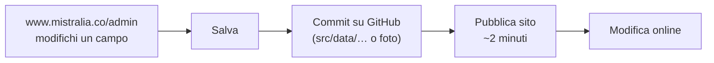
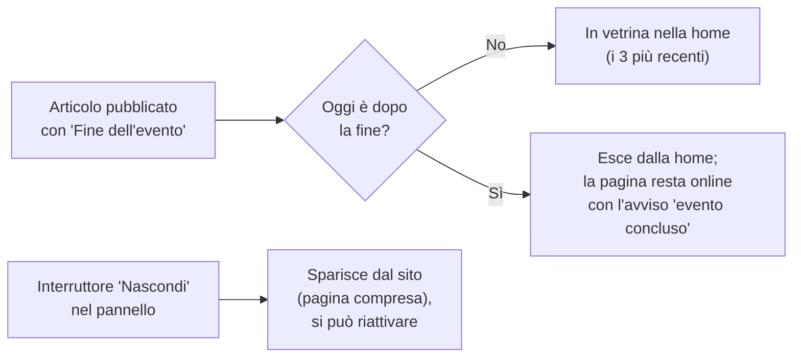
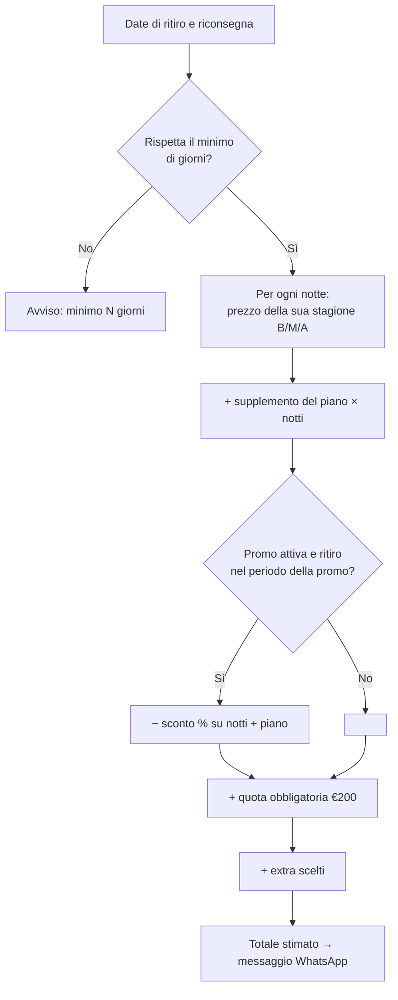

# Il sito www.mistralia.co

[← Indice](README.md)

Il sito è **una pagina sola**, in italiano (`www.mistralia.co/`) e in inglese (`www.mistralia.co/en/`). I visitatori con il browser in una lingua diversa dall'italiano vengono portati da soli alla versione inglese. In più ci sono le pagine degli articoli del Diario: `/diario/<chiave>/` in italiano e `/en/journal/<chiave>/` in inglese.

## Le sezioni della pagina (dall'alto)

| Sezione | Da dove prende i dati |
| --- | --- |
| Logo grande e foto di apertura con il badge "Tutto incluso" | `info.json` → `fotoApertura` |
| Banner della promo (solo se attiva e nelle date giuste) | `promo.md` |
| Cosa è incluso (kit in 8 gruppi) | `info.json` → `kit` |
| Prezzi in 3 passi: stagioni, piani, quota fissa ed extra | `prezzi.json` |
| Calcolatore con richiesta su WhatsApp | `prezzi.json`, `promo.md`, `info.json` → `whatsapp` |
| Disponibilità (calendario delle date occupate) | `info.json` → `calendarioEmbedUrl` |
| Galleria | `info.json` → `galleria` |
| Diario di bordo (compare solo quando c'è almeno un articolo vero) | `src/content/diario/` |
| Ritiro e riconsegna (Modugno, mappa, orari) | `info.json` → `ritiro` |
| Domande frequenti | `info.json` → `faq` |
| Contatti e dati aziendali | `info.json` |

## Il pannello www.mistralia.co/admin

Il modo consigliato per cambiare **prezzi, stagioni, promo, contatti, kit, regole, FAQ e foto** è il pannello: moduli con campi, menu e calendari al posto dei file. Premi **Salva**, il pannello fa il commit su GitHub al posto tuo e *Pubblica sito* mette online la modifica in circa 2 minuti.



**Accesso (una volta per browser):**
1. Crea un token GitHub dedicato al pannello: github.com → foto profilo → **Settings → Developer settings → Personal access tokens → Fine-grained tokens → Generate new token**.
   - Name `pannello-admin`; Expiration 1 anno
   - Repository access: **Only select repositories** → `mistraliagianluca.github.io`
   - Permissions → Repository permissions → **Contents: Read and write** (Metadata si aggiunge da solo), nient'altro
   - Salvalo nel password manager e annotalo in [Sicurezza](05-sicurezza.md#inventario-dei-segreti).
2. Apri **www.mistralia.co/admin** → **Sign In Using Access Token** → incolla il token. Il browser lo ricorda: le volte successive entri direttamente.

**Uso:** *Dati del sito* → scegli **Prezzi, stagioni e condizioni**, **Promozione** oppure **Contatti, ritiro, kit, regole, FAQ e foto** → modifica → **Save**. Le foto si caricano dal campo *Galleria* (anche dal telefono), si trascinano per cambiare l'ordine e finiscono in `public/assets/gallery/`.

**Diario di bordo (articoli):** sezione *Diario di bordo* del pannello. Si vede e si modifica **solo la versione italiana**: titolo, anteprima, testo, immagine, **Fine dell'evento**, interruttore **Nascondi** o **Delete**. La **versione inglese si aggiorna da sola** entro pochi minuti: il bot ritraduce i testi cambiati, copia date, immagine e interruttori, ed elimina l'inglese se elimini l'italiano. Nel gruppo Telegram arriva *"🌍 Versione inglese aggiornata"*. Gli articoli nuovi li crea solo il bot.

**Ordine dell'elenco:** in cima gli articoli **🟢 in vetrina**, sotto quelli **⚪ evento concluso** e **⚫ nascosto**, ognuno dal più recente. Lo stato lo aggiorna il bot entro 1–2 minuti da ogni modifica, e a mezzanotte per quelli che scadono. Il pannello ricorda l'ultimo ordinamento scelto con *Sort*: per tornare a questo scegli *Ordine*, decrescente.

**Cosa NON si cambia dal pannello:** i testi fissi del sito (`src/i18n/`), i nomi dei piani e le impostazioni dell'automazione. Per questi vedi la tabella qui sotto.

**Da sapere:**
- Il pannello è solo per Gianluca: per entrare serve un token con accesso in scrittura al repository. Chi apre `/admin` senza token vede solo la schermata di accesso, e la pagina non compare su Google (`noindex`).
- Ogni Salva è un commit visibile nella storia del repository, quindi si può sempre tornare indietro ([Sviluppo → Tornare indietro](06-sviluppo.md#tornare-indietro)).
- Se lavori anche dal Mac, fai `git pull` prima di modificare, perché il pannello cambia i file su GitHub.
- Il pannello è [Sveltia CMS](https://sveltiacms.app), gratuito e open source, caricato da unpkg.com. La configurazione dei campi è in `public/admin/config.yml`: se la cambi, aggiorna questa pagina e il registro delle modifiche.

## Cosa si modifica e dove

| Voglio cambiare… | File | Come |
| --- | --- | --- |
| **Prezzo al giorno** di una stagione | pannello → Prezzi · oppure `src/data/prezzi.json` → `prezzoGiorno` | `B` bassa, `M` media, `A` alta |
| **In che stagione** è un giorno | pannello → Prezzi → *Stagioni (periodi)* · oppure `prezzi.json` → `periodi` | Elenco di periodi `dal`–`al` con la stagione. I giorni non coperti valgono come media; un anno senza periodi usa quelli dell'ultimo anno presente. **Per un anno nuovo aggiungi i suoi periodi** |
| **Noleggio minimo** | `prezzi.json` → `minimoGiorni`, `minimoEccezioni` | Le eccezioni valgono per i ritiri tra `dal` e `al` |
| **Piani** (supplemento, cauzione, franchigia) | `prezzi.json` → `piani` | `supplementoGiorno` in euro al giorno |
| **Quota obbligatoria** (pulizia, preparazione, check-in) | `prezzi.json` → `servizio` | Si paga una volta per noleggio |
| **Extra** (lenzuola, asciugamani, barbecue, transfer) | `prezzi.json` → `extra` | Prezzo per noleggio |
| **Promo** (es. Black Friday) | pannello → Promozione · oppure `src/data/promo.md` | vedi [Promo](#promo) |
| **Numero WhatsApp**, telefoni, email | `src/data/info.json` | `whatsapp` senza `+` e senza spazi (es. `393756473839`) |
| **Indirizzo e orari di ritiro** | `info.json` → `ritiro` | È l'indirizzo che vedono i clienti, non la sede legale |
| **Kit incluso, preparazione, riconsegna, regole** | `info.json` | Sempre in italiano **e** inglese |
| **Domande frequenti** | `info.json` → `faq` | Una FAQ che contiene `DA_CONFERMARE` non viene mostrata |
| **Foto della galleria** | pannello → Contatti… → *Galleria* · oppure `public/assets/gallery/` + `info.json` → `galleria` | vedi [Foto](#foto) |
| **Testi fissi** (titoli, pulsanti, frasi) | `src/i18n/it.json` e `src/i18n/en.json` | Stesse chiavi in tutti e due i file |
| **Articoli del Diario** | pannello → Diario di bordo · oppure `src/content/diario/` | Li scrive il bot; vedi [Articoli scaduti e nascosti](#articoli-scaduti-e-nascosti) |
| Aspetto, colori, struttura | `src/components/`, `src/layouts/`, `src/styles/global.css` | Solo per chi sviluppa ([Sviluppo](06-sviluppo.md)) |

### In alternativa: modificare un file con l'editor web di GitHub

1. Apri `github.com/mistraliagianluca/mistraliagianluca.github.io` e vai al file, per esempio `src/data/prezzi.json`.
2. Premi l'icona della **matita ✏️** in alto a destra.
3. Cambia solo il valore. **Non togliere virgolette, virgole o parentesi**: in un file `.json` basta una virgola sbagliata per bloccare la pubblicazione.
4. Premi **Commit changes…** → scrivi cosa hai cambiato (es. *"Prezzo alta stagione 160"*) → **Commit changes**.
5. Vai in **Actions**: parte *Pubblica sito*. Se diventa verde, dopo circa 2 minuti la modifica è online.
6. Se diventa rossa ❌, il sito **resta com'era** e la tua modifica ha un errore di formato. Apri il file, correggilo oppure annulla la modifica (vedi [Sviluppo → Tornare indietro](06-sviluppo.md#tornare-indietro)).

Le modifiche a prezzi, promo, testi e foto **non** richiedono una riga nel registro delle modifiche: sono contenuti, non codice.

## Promo

Una sola promo alla volta. Nel pannello è la scheda **Promozione**; nel file `src/data/promo.md` i campi sono questi:

```yaml
attiva: false               # true = accesa, false = spenta subito
nome: "Black Friday"
sconto: 15                  # percentuale
mostra_dal: "2026-11-24"    # il banner compare da questo giorno…
mostra_al: "2026-12-01"     # …e sparisce da solo dopo questo
noleggi_dal: "2027-03-01"   # lo sconto vale solo per i noleggi che INIZIANO in questo periodo
noleggi_al: "2027-05-31"
titolo_it: "Black Friday: −15% sui noleggi di primavera"
titolo_en: "Black Friday: 15% off spring rentals"
```

- Lo sconto si applica **solo** a notti e piano, non alla quota obbligatoria né agli extra.
- Banner e riga dello sconto sono già nella pagina, nascosti: è il **browser del visitatore** a mostrarli solo tra *Banner visibile dal* e *fino al*. Compaiono e spariscono da soli a mezzanotte, senza bisogno di ricostruire il sito.
- Per vedere subito il banner (per esempio per una prova), metti come *Banner visibile dal* la data di oggi.
- Per una nuova promo cambia i valori e metti `attiva: true` (nel pannello: l'interruttore *Promo attiva*).
- Salvando dal pannello i commenti `#` del file spariscono: le spiegazioni restano qui e nei suggerimenti dei campi.

## Articoli scaduti e nascosti



- **Fine dell'evento** (`scadenza`): la scrive il bot quando il post parla di un evento con date, ed è controllata dal verificatore. Per luoghi e itinerari è vuota e l'articolo non scade. Si può correggere dal pannello.
- Dal giorno dopo la scadenza l'articolo **esce dalla home** e la sua pagina mostra *"Questo evento si è concluso il … · Scopri le prossime idee di viaggio"*. La pagina **resta online** apposta, così i link già condivisi sui social non portano a una pagina inesistente. Lo decide il browser del visitatore in base alla data: non serve ricostruire il sito.
- La home mostra i **3 articoli più recenti non scaduti**. Se sono tutti scaduti, la sezione Diario sparisce.
- **Nascondi** (`nascosto: true`): l'articolo sparisce del tutto dal sito ma il file resta, e si può riaccendere. Serve per un articolo sbagliato o non più adatto.
- **Elimina** (*Delete* nel pannello): toglie per sempre l'articolo dal repository (resta nella storia di git); il bot elimina anche la versione inglese. L'immagine in `public/assets/diario/` resta e si può cancellare dalla libreria media del pannello.
- **Versione inglese:** non va mai modificata a mano, perché viene riscritta a ogni modifica dell'italiano. Si corregge l'italiano e la traduzione segue. Dettagli in [Automazione → Traduzioni](04-automazione.md#versione-inglese-degli-articoli).
- I **post social** non vengono toccati: è normale che i post di eventi passati restino sul profilo.

## Foto

- **Dal pannello:** campo *Galleria* → **carica** le foto o scegli tra quelle già caricate → trascina per l'ordine → Salva. Le foto finiscono in `public/assets/gallery/`. Usa foto orizzontali in JPG, meglio sotto i 500 KB.
- **Foto di apertura** (quella grande in alto): campo *Foto grande in cima* (`info.json` → `fotoApertura`, oggi `/assets/gallery/SER.jpg`). Se il file non c'è, il sito usa la *Foto di riserva* (`fotoAperturaRiserva`). Maiuscole e minuscole nel nome del file non contano.
- In `info.json` la galleria è un elenco di percorsi (`"/assets/gallery/7.jpg"`). Per compatibilità il sito accetta anche il vecchio formato a numeri (`7`).
- Le foto `1.jpg` e `2.jpg` servono anche a Gemini come **riferimento del camper** per le immagini dei post (`automazione/config.json` → `fotoRiferimento`). **Non cancellarle**; se le sostituisci, scegli foto in cui il Kentucky si veda bene e intero.

## Calendario

1. Su Google Calendar crea il calendario **"Mistralia – occupato"** e segna come eventi i giorni già venduti, **anche quelli presi da Yescapa o Indie**.
2. In *Impostazioni del calendario → Autorizzazioni di accesso* attiva **Rendi disponibile pubblicamente** con *Mostra solo disponibilità (nascondi dettagli)*.
3. In *Integra calendario* copia l'**URL dell'incorporamento** e incollalo in `info.json` → `calendarioEmbedUrl`.

Finché `calendarioEmbedUrl` è vuoto, il sito mostra un invito a scrivere su WhatsApp. Il calendario **non** si sincronizza con Yescapa e Indie: va aggiornato a mano, è una scelta voluta per tenere bassi costi e complessità.

## Come calcola il prezzo il calcolatore



Il totale è una **stima**: il prezzo definitivo lo conferma il team su WhatsApp.

## Cose ancora da completare

Cerca `DA_CONFERMARE` nei file di `src/data/`. L'elenco aggiornato di correzioni e dati da confermare è nel log del progetto su Claude (*log-modifiche-sito*). I punti principali:
- supplementi e cauzioni dei piani Plus e Premium, km inclusi, franchigie;
- età minima e anni di patente, condizioni di cancellazione (FAQ);
- l'indirizzo della sezione calendario (`calendarioEmbedUrl`);
- facoltativo: statistiche anonime con GoatCounter (`info.json` → `goatcounter`).

## Dominio e pubblicazione

- Il dominio è scritto in `public/CNAME` (`www.mistralia.co`). **Non cancellare questo file**: senza, il sito torna all'indirizzo `mistraliagianluca.github.io`.
- In GitHub → **Settings → Pages** deve esserci *Source: GitHub Actions*, il dominio personalizzato e **Enforce HTTPS** attivo.
- Il DNS del dominio è gestito dal registrar di `mistralia.co`; l'unico con accesso è Gianluca. Vedi [Architettura → Account](01-architettura.md#account-e-servizi-esterni).
