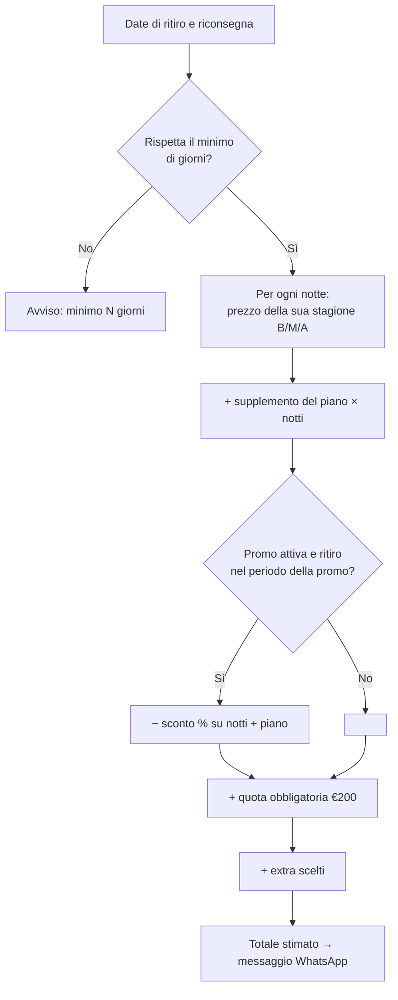

# Il sito www.mistralia.co

[← Indice](README.md)

Il sito è **una pagina sola**, in italiano (`www.mistralia.co/`) e in inglese (`www.mistralia.co/en/`). I visitatori con il browser in una lingua diversa dall'italiano vengono portati da soli alla versione inglese. In più ci sono le pagine degli articoli del Diario: `/diario/<chiave>/` in italiano e `/en/journal/<chiave>/` in inglese.

## Le sezioni della pagina (dall'alto)

| Sezione | Da dove prende i dati |
| --- | --- |
| Logo grande e foto di apertura con il badge "Tutto incluso" | `info.json` → `fotoApertura` |
| Banner della promo (solo se attiva e nelle date giuste) | `promo.md` |
| Cosa è incluso (kit in 8 gruppi) | `info.json` → `kit` |
| Prezzi in 3 passi: stagioni, piani, quota fissa ed extra | `prezzi.json` |
| Calcolatore con richiesta su WhatsApp | `prezzi.json`, `promo.md`, `info.json` → `whatsapp` |
| Disponibilità (calendario delle date occupate) | `info.json` → `calendarioEmbedUrl` |
| Galleria | `info.json` → `galleria` |
| Diario di bordo (compare solo quando c'è almeno un articolo vero) | `src/content/diario/` |
| Ritiro e riconsegna (Modugno, mappa, orari) | `info.json` → `ritiro` |
| Domande frequenti | `info.json` → `faq` |
| Contatti e dati aziendali | `info.json` |

## Cosa si modifica e dove

| Voglio cambiare… | File | Come |
| --- | --- | --- |
| **Prezzo al giorno** di una stagione | `src/data/prezzi.json` → `prezzoGiorno` | `B` bassa, `M` media, `A` alta |
| **In che stagione** è un giorno | `src/data/prezzi.json` → `stagioni` → anno → mese | Una lettera per giorno del mese (`B`, `M` o `A`). Il mese `"7"` di luglio ha 31 lettere |
| **Noleggio minimo** | `prezzi.json` → `minimoGiorni`, `minimoEccezioni` | Le eccezioni valgono per i ritiri tra `dal` e `al` |
| **Piani** (supplemento, cauzione, franchigia) | `prezzi.json` → `piani` | `supplementoGiorno` in euro al giorno |
| **Quota obbligatoria** (pulizia, preparazione, check-in) | `prezzi.json` → `servizio` | Si paga una volta per noleggio |
| **Extra** (lenzuola, asciugamani, barbecue, transfer) | `prezzi.json` → `extra` | Prezzo per noleggio |
| **Promo** (es. Black Friday) | `src/data/promo.md` | vedi [Promo](#promo) |
| **Numero WhatsApp**, telefoni, email | `src/data/info.json` | `whatsapp` senza `+` e senza spazi (es. `393756473839`) |
| **Indirizzo e orari di ritiro** | `info.json` → `ritiro` | È l'indirizzo che vedono i clienti, non la sede legale |
| **Kit incluso, preparazione, riconsegna, regole** | `info.json` | Sempre in italiano **e** inglese |
| **Domande frequenti** | `info.json` → `faq` | Una FAQ che contiene `DA_CONFERMARE` non viene mostrata |
| **Foto della galleria** | `public/assets/gallery/` + `info.json` → `galleria` | vedi [Foto](#foto) |
| **Testi fissi** (titoli, pulsanti, frasi) | `src/i18n/it.json` e `src/i18n/en.json` | Stesse chiavi in tutti e due i file |
| **Articoli del Diario** | `src/content/diario/` | Li scrive il bot; vedi [Sviluppo](06-sviluppo.md#togliere-un-articolo) per toglierli |
| Aspetto, colori, struttura | `src/components/`, `src/layouts/`, `src/styles/global.css` | Solo per chi sviluppa ([Sviluppo](06-sviluppo.md)) |

### Modificare un file senza computer (editor web di GitHub)

1. Apri `github.com/mistraliagianluca/mistraliagianluca.github.io` e vai al file, per esempio `src/data/prezzi.json`.
2. Premi l'icona della **matita ✏️** in alto a destra.
3. Cambia solo il valore. **Non togliere virgolette, virgole o parentesi**: in un file `.json` basta una virgola sbagliata per bloccare la pubblicazione.
4. Premi **Commit changes…** → scrivi cosa hai cambiato (es. *"Prezzo alta stagione 160"*) → **Commit changes**.
5. Vai in **Actions**: parte *Pubblica sito*. Se diventa verde, dopo circa 2 minuti la modifica è online.
6. Se diventa rossa ❌, il sito **resta com'era** e la tua modifica ha un errore di formato. Apri il file, correggilo oppure annulla la modifica (vedi [Sviluppo → Tornare indietro](06-sviluppo.md#tornare-indietro)).

Le modifiche a prezzi, promo, testi e foto **non** richiedono una riga nel registro delle modifiche: sono contenuti, non codice.

## Promo

Il file `src/data/promo.md` contiene una sola promo alla volta:

```yaml
attiva: false               # true = accesa, false = spenta subito
nome: "Black Friday"
sconto: 15                  # percentuale
mostra_dal: "2026-11-24"    # il banner compare da questo giorno…
mostra_al: "2026-12-01"     # …e sparisce da solo dopo questo
noleggi_dal: "2027-03-01"   # lo sconto vale solo per i noleggi che INIZIANO in questo periodo
noleggi_al: "2027-05-31"
titolo_it: "Black Friday: −15% sui noleggi di primavera"
titolo_en: "Black Friday: 15% off spring rentals"
```

- Lo sconto si applica **solo** a notti e piano, non alla quota obbligatoria né agli extra.
- Il sito si ricostruisce **ogni notte**, quindi il banner compare e sparisce da solo nelle date giuste anche se nessuno tocca niente.
- Per una nuova promo cambia i valori e metti `attiva: true`.

## Foto

- La galleria mostra le foto `public/assets/gallery/1.jpg`, `2.jpg`, … nell'ordine scritto in `info.json` → `galleria` (es. `[3, 1, 2]`).
- **Aggiungere una foto:** caricala in `public/assets/gallery/` con il numero successivo (es. `21.jpg`) e aggiungi `21` alla lista `galleria`. Formato orizzontale, JPG, meglio sotto i 500 KB.
- **Foto di apertura** (quella grande in alto): `info.json` → `fotoApertura`. Può essere un numero della galleria o il nome di un file in `public/assets/gallery/` (ora `SER.JPG`; maiuscole e minuscole non contano). Se il file non c'è, il sito usa `fotoAperturaRiserva`.
- Le foto `1.jpg` e `2.jpg` servono anche a Gemini come **riferimento del camper** per le immagini dei post (`automazione/config.json` → `fotoRiferimento`). Se le cambiate, scegliete foto in cui il Kentucky si veda bene e intero.

## Calendario

1. Su Google Calendar crea il calendario **"Mistralia – occupato"** e segna come eventi i giorni già venduti, **anche quelli presi da Yescapa o Indie**.
2. In *Impostazioni del calendario → Autorizzazioni di accesso* attiva **Rendi disponibile pubblicamente** con *Mostra solo disponibilità (nascondi dettagli)*.
3. In *Integra calendario* copia l'**URL dell'incorporamento** e incollalo in `info.json` → `calendarioEmbedUrl`.

Finché `calendarioEmbedUrl` è vuoto, il sito mostra un invito a scrivere su WhatsApp. Il calendario **non** si sincronizza con Yescapa e Indie: va aggiornato a mano, è una scelta voluta per tenere bassi costi e complessità.

## Come calcola il prezzo il calcolatore



Il totale è una **stima**: il prezzo definitivo lo conferma il team su WhatsApp.

## Cose ancora da completare

Cerca `DA_CONFERMARE` nei file di `src/data/`. L'elenco aggiornato di correzioni e dati da confermare è nel log del progetto su Claude (*log-modifiche-sito*). I punti principali:
- supplementi e cauzioni dei piani Plus e Premium, km inclusi, franchigie;
- età minima e anni di patente, condizioni di cancellazione (FAQ);
- l'indirizzo della sezione calendario (`calendarioEmbedUrl`);
- facoltativo: statistiche anonime con GoatCounter (`info.json` → `goatcounter`).

## Dominio e pubblicazione

- Il dominio è scritto in `public/CNAME` (`www.mistralia.co`). **Non cancellare questo file**: senza, il sito torna all'indirizzo `mistraliagianluca.github.io`.
- In GitHub → **Settings → Pages** deve esserci *Source: GitHub Actions*, il dominio personalizzato e **Enforce HTTPS** attivo.
- Il DNS del dominio è gestito dal registrar di `mistralia.co`; l'unico con accesso è Gianluca. Vedi [Architettura → Account](01-architettura.md#account-e-servizi-esterni).
