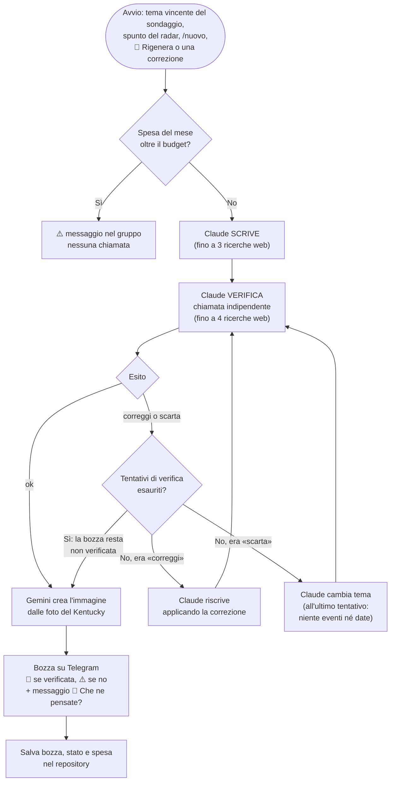
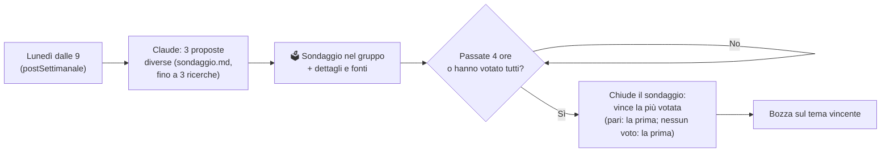
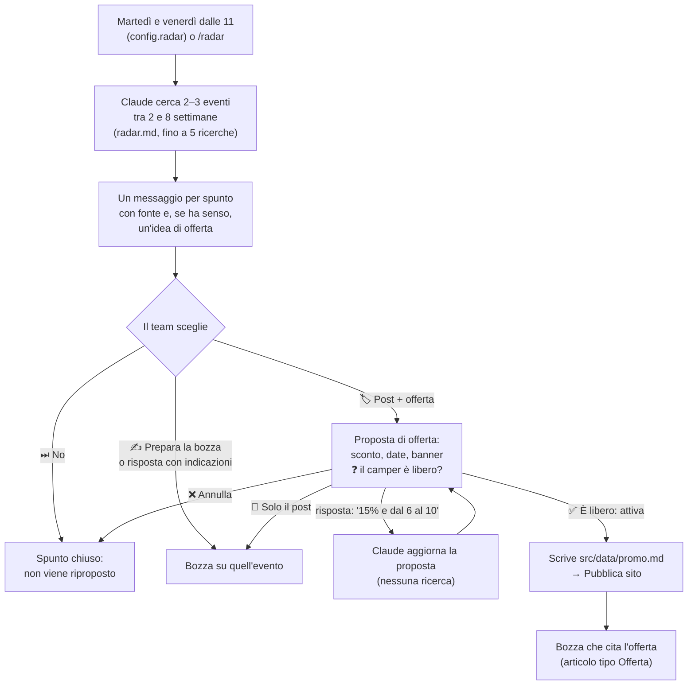
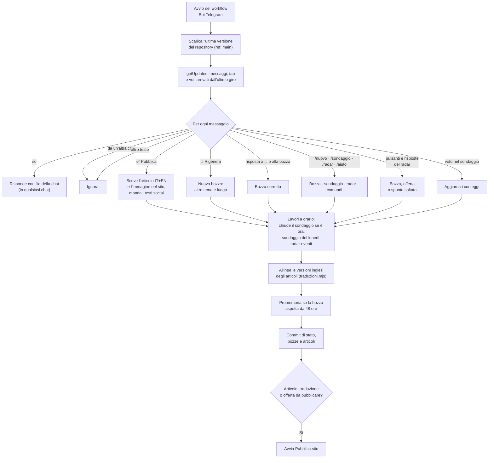

# Automazione: post settimanale e bot

[← Indice](README.md)

Tutto il codice sta in `automazione/`, è scritto in JavaScript per Node 22 e **non ha dipendenze**: niente `npm install` e niente librerie da aggiornare.

| File | Ruolo |
| --- | --- |
| `genera.mjs` | Prepara una bozza: scrittura, verifica dei fatti, immagine, invio su Telegram con il messaggio 💬 *Che ne pensate?* |
| `telegram.mjs` | Il bot: legge il gruppo ed esegue Pubblica, Rigenera, correzioni, voti e comandi; poi i lavori a orario |
| `sondaggio.mjs` + `sondaggio.md` | **Sondaggio del lunedì**: 3 proposte di tema, voto nel gruppo, bozza sul tema vincente |
| `radar.mjs` + `radar.md` | **Radar eventi**: cerca eventi tra 2 e 8 settimane, li propone con i pulsanti, attiva l'offerta sul sito dopo la conferma |
| `lib.mjs` | Funzioni comuni: chiamate a Claude, Gemini e Telegram, stato, spesa, modalità di prova |
| `prompt.md` | **Istruzioni a Claude per scrivere** il post: fatti sul camper, mete, durata, tono, formato |
| `verifica.md` | **Istruzioni al verificatore** dei fatti |
| `config.json` | Impostazioni: modelli, limiti, budget, foto di riferimento, orari di sondaggio e radar |
| `stato.json` | Memoria del bot. **Non modificare a mano** |
| `bozze/` | Una cartella per ogni bozza (`bozza.json` + `immagine.jpg`) |
| `traduzioni.mjs` | Tiene la versione inglese di ogni articolo allineata a quella italiana (traduce, copia, elimina) |
| `documentazione.mjs` | Rigenera `docs/riferimento.md` e controlla il registro delle modifiche |

## Come nasce una bozza



**Gli avvii possibili:**

| Avvio | Da dove | Cosa cambia |
| --- | --- | --- |
| Sondaggio del lunedì | il **Bot Telegram**, quando il sondaggio si chiude (vedi [Il sondaggio del lunedì](#il-sondaggio-del-lunedì)) | Bozza sul tema che ha vinto. Con `sondaggio.attivo: false` in `config.json` il lunedì arriva direttamente la bozza, come prima |
| Spunto del radar | ✍️ *Prepara la bozza*, 🏷 *Post + offerta* o una risposta allo spunto | Bozza su quell'evento; con l'offerta attivata, il post la cita e l'articolo è di tipo *Offerta* (vedi [Il radar eventi](#il-radar-eventi)) |
| Avvio a mano | workflow *Post settimanale* → Run workflow | Solo per emergenze; con la sveglia ogni minuto può essere cancellato da un giro del bot (vedi sotto). Meglio `/nuovo` |
| `/nuovo` | Bot Telegram | Bozza nuova subito. `/nuovo` seguito da un testo (es. `/nuovo un weekend a Matera per l'Immacolata`) passa a Claude le indicazioni |
| 🔄 Rigenera | Bot Telegram | Claude riceve la bozza scartata e deve cambiare **evento e luogo** |
| Risposta al messaggio 💬 (o alla bozza) | Bot Telegram | Stesso tema, luogo e offerta, applica la correzione; l'immagine si rifà solo se la correzione la riguarda |

**Il messaggio 💬 *Che ne pensate?*** arriva subito sotto ogni bozza: è il messaggio a cui rispondere per le correzioni (funziona anche rispondere alla foto o al testo, come prima). Contiene **cosa controllare prima di pubblicare**: 1–3 punti scritti dal verificatore (campo `da_controllare` di `verifica.md`, es. *"le date 12–13 dicembre → comune.agnone.is.it"*) più, sempre, il controllo dell'immagine.

**Tipo di articolo (`categoria`):** Claude scrive `evento` se il post parla di un evento con date e `idea` per luoghi e itinerari; il bot mette `offerta` quando la bozza nasce da un'offerta attivata, e in quel caso la `scadenza` è l'ultimo giorno del banner della promo. Con Pubblica finisce nell'articolo (anche in quello inglese).

### Le regole che Claude segue (`prompt.md`)

- **Mete:** raggiungibili in circa 4 ore di guida da Bari (Puglia, Basilicata, Campania, Calabria, Molise, Abruzzo) o con un **traghetto diretto da Bari** (Grecia, Albania, Montenegro, Croazia). Deve alternare le regioni e indicare il tempo di viaggio. Il limite di ore è `oreMaxDaBari` in `config.json`.
- **Traghetti:** solo se ha verificato che nel periodo c'è una linea da Bari che **imbarca camper**. Cita la compagnia e la durata della traversata, senza prezzi.
- **Durata del viaggio:** entro 2 ore → weekend lungo; 3–4 ore → 4–7 giorni; traghetto ed estero → 7–10 giorni, d'estate due settimane. Da giugno a settembre privilegia viaggi lunghi in periodi poco affollati (giugno, inizio luglio, settembre); nel resto dell'anno weekend lunghi e ponti. Niente gite di un giorno.
- **Messaggio:** il camper è **completo di tutto per partire** (pieno, cucina, sosta libera, assistenza 24/7). Lenzuola e asciugamani **non sono inclusi**: mai dire che lo sono, e mai formule come "tutto incluso tranne le lenzuola".
- **Fatti sul camper:** solo quelli scritti nel prompt. I km inclusi al giorno li prende da `src/data/prezzi.json` (`kmInclusiGiorno`), come il prezzo. **Mai citare età o anno del camper**, mai prezzi diversi da "da €X al giorno", dove X è il prezzo più basso in `src/data/prezzi.json`: se cambi i prezzi dal pannello, i post si aggiornano da soli.
- **Date di eventi:** solo se verificate in una fonte trovata al momento.
- **Mai suggerire dove dormire o sostare** (aree sosta, campeggi, parcheggi, agriturismi, spiagge o piazzali per la notte): dove fermarsi lo scelgono i clienti. Si può dire che il Kentucky è attrezzato per la sosta libera, senza indicare luoghi. Il verificatore controlla anche questo e, se trova un suggerimento, fa correggere la bozza.
- **Scadenza:** se il post parla di un evento con date, Claude scrive anche il campo `scadenza` (ultimo giorno dell'evento). Con Pubblica finisce nell'articolo: dal giorno dopo l'articolo esce dalla home e la pagina dice "evento concluso" ([Il sito → Articoli scaduti](03-sito.md#articoli-scaduti-archiviati-ed-eliminati)).
- **Temi già usati:** riceve gli ultimi 12 temi, con il luogo, e non deve ripeterli. Fa eccezione il **tema scelto dal team** (sondaggio, radar): lì il tema è imposto e Claude non lo cambia; se l'evento non si conferma, parla del luogo senza date.
- **Nota sull'immagine:** il camper è sempre quello vero e solo l'ambientazione è creata con l'AI. La nota la aggiunge il bot ai testi per i social (*"📸 Ambientazione creata con l'AI, il camper è quello vero."*), e il sito la mostra sotto l'immagine dell'articolo (`ai_image` in `src/i18n/`).
- **Immagine:** "reale" (il Kentucky nel luogo) oppure, una settimana su 4, "improbabile" (il Kentucky in un posto impossibile e simpatico).
- **Tono:** fresco, frasi corte, massimo 3 emoji, niente finta urgenza e niente recensioni inventate.

Per cambiare tono o regole si modifica `prompt.md`: è testo normale. Se cambiano le condizioni di noleggio, aggiorna la sezione *Chi siamo* del prompt.

### La verifica dei fatti (`verifica.md`)

Una **seconda chiamata a Claude**, separata dalla prima, rilegge la bozza e cerca da sola sul web ogni fatto su eventi e luoghi: nome, **edizione di quest'anno**, date, luogo, ingresso, traghetti (linea, periodo, imbarco camper), tempi di viaggio e la **scadenza** dell'evento. Non si fida delle fonti della prima chiamata, e una pagina dell'anno precedente non vale come conferma.

| Esito | Cosa succede |
| --- | --- |
| `ok` | La bozza parte con *🔎 Fatti verificati su: …* e i link |
| `correggi` | L'evento esiste ma un dettaglio è sbagliato: Claude riscrive e si verifica di nuovo |
| `scarta` | Evento non confermato o traghetto non verificato: Claude cambia tema |
| Tentativi esauriti | La bozza arriva con ⚠️ e l'elenco dei problemi: **non va pubblicata** |

Il numero di tentativi è `tentativiVerifica` in `config.json`, oggi 2. Il rischio di un errore non è zero, ma per proporre un evento falso dovrebbero sbagliare due chiamate indipendenti con ricerche separate.

## Il sondaggio del lunedì



- Le 3 proposte sono diverse tra loro (per esempio un evento, un borgo di stagione, un itinerario). La prima è quella che Claude consiglia: vince se nessuno vota o in caso di pareggio.
- Il sondaggio non è anonimo: si vede chi ha votato cosa.
- "Hanno votato tutti" = votanti uguali ai membri del gruppo meno il bot (`getChatMemberCount`).
- Si può avviare anche a mano con `/sondaggio`. Mentre un sondaggio è aperto non se ne apre un altro.
- Impostazioni in `config.json` → `sondaggio`: `attivo` (false = bozza diretta il lunedì), `ore` (durata del voto, oggi 4), `ricerche` (oggi 3).
- Come il post del lunedì, se la preparazione fallisce il bot **non riprova da solo**: scrive l'errore e si usa `/nuovo` o `/sondaggio`.

## Il radar eventi



- **Cosa cerca:** concerti, mostre ed eventi d'arte, festival, teatro, sagre, grandi eventi sportivi, fiere, mercatini, rievocazioni, nelle mete raggiungibili da Bari (stesse regole del post). Ogni evento deve avere una fonte che conferma **l'edizione di quest'anno**; gli eventi già proposti o pubblicati non tornano.
- **L'idea di offerta:** Claude la propone solo se ha senso, cioè in bassa o media stagione o per un grande evento; mai in alta stagione. Riceve il calendario delle stagioni da `src/data/prezzi.json`. Sconto tra 5 e 15%, sui noleggi che iniziano poco prima dell'evento; banner da oggi fino al giorno prima. Il bot scarta le proposte con date non valide.
- **Prima di attivare** il bot chiede se il camper è libero (il calendario va guardato da una persona) e avvisa se c'è già una promo attiva che verrebbe sostituita. Con ✅ il bot scrive la promo in `src/data/promo.md` mantenendo commenti e campi che non conosce, il workflow la salva su GitHub e avvia *Pubblica sito*: banner, sconto nel calcolatore e, dopo la pubblicazione dell'articolo, l'articolo in evidenza.
- La promo attivata dal bot si modifica o si spegne come sempre dal pannello → *Promozione*.
- Gli spunti restano nello stato (`spunti`, ultimi 30). Un pulsante premuto due volte o su uno spunto già gestito risponde *"Questo spunto è già stato gestito"*.
- Impostazioni in `config.json` → `radar`: `attivo`, `giorni` (1 = lunedì … 7 = domenica, oggi `[2, 5]`), `ora` (oggi 11), `spunti` (3), `ricerche` (5), `settimaneDa`/`settimaneA` (2 e 8).
- **Non suggerisce mai dove dormire o sostare**, come i post.

## Cosa fa il bot a ogni giro



- Dopo ogni messaggio il bot salva subito il punto in cui è arrivato (`offset`): se un passaggio fallisce, lo stesso messaggio **non** viene rieseguito all'infinito.
- La conferma del tap (*answerCallbackQuery*) Telegram la accetta solo per pochi secondi. Il bot passa più di rado, quindi la conferma di solito è scaduta: il bot la ignora e scrive invece un messaggio nel gruppo.
- I pulsanti contengono un codice corto di 10 caratteri e non l'identificativo della bozza, perché Telegram accetta al massimo 64 byte.
- I **lavori a orario** (sondaggio, radar) si segnano nello stato *prima* di partire: se falliscono non vengono ritentati a ogni giro, così un errore non costa più volte.
- Due giri non lavorano mai insieme: i workflow del bot e del post sono nello stesso gruppo di *concurrency* `automazione` e partono uno dopo l'altro, ognuno con l'ultima versione del repository.

## Chiamate a Claude: errori e nuovi tentativi

`chiediClaude` in `lib.mjs` gestisce da sola gli intoppi più comuni dell'API, senza fallire subito:

| Intoppo | Cosa fa |
| --- | --- |
| API sovraccarica o in errore (429, 500, 502, 503, 529) o risposta vuota | riprova fino a 2 volte, dopo 20 e 40 secondi |
| Risposta interrotta durante le ricerche web (`pause_turn`) | rimanda la conversazione per farla finire |
| Risposta senza un JSON valido (troncata o solo testo) | chiede a Claude di ripetere solo il blocco JSON, senza nuove ricerche |
| Ancora niente dopo 4 giri | errore *"Claude non ha restituito un JSON valido"* nel gruppo; si riprova con `/nuovo` |

Il limite di lunghezza della risposta è 16.000 token. Ogni giro in più costa come una chiamata breve, cioè pochi centesimi, e la spesa resta contata nel totale del mese.

## Versione inglese degli articoli

Gli articoli si modificano **solo in italiano**: dal pannello, dall'editor web o dal Mac. A ogni giro il bot confronta ogni `<chiave>.it.md` con il suo `<chiave>.en.md`:

| Nell'italiano è cambiato… | Il bot… | Costo |
| --- | --- | --- |
| titolo, anteprima o testo | fa tradurre a Claude e riscrive l'inglese (senza ricerche web), poi scrive *"🌍 Versione inglese aggiornata"* nel gruppo | ~$0,02–0,05 |
| data, fine dell'evento, tipo di articolo, nascosto, immagine | copia il valore nell'inglese | gratis |
| file eliminato | elimina anche l'inglese | gratis |
| niente | niente | gratis |

- Il file inglese conserva in `origine` l'**impronta** del testo italiano da cui è stato tradotto. Finché l'italiano non cambia, nessuna chiamata a Claude.
- Se la traduzione fallisce, il bot lo scrive nel gruppo e **non riprova ogni minuto**: riprova alla prossima modifica dell'italiano. Le fallite sono in `stato.json` → `traduzioniFallite`.
- Gli articoli pubblicati con ✅ Pubblica nascono già allineati: l'inglese lo scrive Claude insieme all'italiano, con l'impronta.
- Dopo un aggiornamento il bot ripubblica il sito. Per circa 2 minuti la pagina inglese può mostrare la versione precedente.
- La spesa delle traduzioni entra nel totale del mese e nel tetto `budgetMensileDollari`.
- Nello stesso passaggio il bot aggiorna nel file **italiano** due campi per il pannello: `stato` (🟢 in vetrina, ⚪ evento concluso, ⚫ archiviato) e `ordine` (`1-AAAA-MM-GG` per quelli in vetrina, `0-AAAA-MM-GG` per gli altri). Ordinando per `ordine` decrescente compaiono prima quelli in vetrina e poi gli altri, ognuno dal più recente. Non cambiano la traduzione e non ripubblicano il sito.

## La sveglia del bot

Il bot **non è un programma sempre acceso**. GitHub lo avvia, il bot controlla Telegram per qualche secondo e si spegne. Qualcuno deve dirgli quando avviarsi: è la *sveglia*.

| Sveglia | Come funziona | Affidabilità |
| --- | --- | --- |
| **cron-job.org** (✅ attiva dal 22/11/2026) | Un servizio gratuito chiama GitHub **ogni minuto** e avvia *Bot Telegram* | Puntuale al minuto: risposte in 1–2 minuti |
| **Timer di GitHub** (riserva) | `cron` dentro `telegram.yml`, dalle 7 alle 22 | ⚠️ Scarsa: GitHub avvisa che i giri programmati possono essere ritardati o saltati. Il 22/11/2026 ha registrato ritardi di 3 e 7 ore |
| **A mano** | GitHub → Actions → *Bot Telegram* → **Run workflow** | Immediata, utile per test e urgenze |

**Stato attuale:** sveglia principale cron-job.org ogni minuto, timer di GitHub come riserva. Account cron-job.org e token: Gianluca.

### Giri "cancelled" in Actions: è normale

GitHub tiene **un solo giro in esecuzione e uno in attesa** per il gruppo `automazione`. Un giro dura 30–60 secondi, quindi con una chiamata al minuto capita spesso che arrivi una nuova chiamata mentre un'altra è già in attesa. GitHub allora cancella quella in attesa e tiene la più recente, con il messaggio *"Canceling since a higher priority waiting request for automazione exists"*. **Non si perde niente:** ogni giro legge tutti i messaggi arrivati da quello precedente.

Per questo la bozza del lunedì la prepara il bot e non un workflow separato: un workflow diverso nello stesso gruppo potrebbe essere cancellato da un giro del bot. Se le righe grigie in Actions danno fastidio, si può portare la sveglia a ogni 2 minuti.

### Attivare cron-job.org

1. **Token GitHub con un solo permesso:** su github.com → foto profilo → **Settings → Developer settings → Personal access tokens → Fine-grained tokens → Generate new token**.
   - Name `cron-job`; Expiration 1 anno
   - Repository access: **Only select repositories** → `mistraliagianluca.github.io`
   - Permissions: **Actions → Read and write**, nient'altro
   - Salvalo **solo nel password manager** e segna la scadenza in [Sicurezza](05-sicurezza.md#inventario-dei-segreti).
2. Su **cron-job.org** (registrazione gratuita) → **Create cronjob**:
   - URL: `https://api.github.com/repos/mistraliagianluca/mistraliagianluca.github.io/actions/workflows/telegram.yml/dispatches`
   - Schedule: ogni minuto (o ogni 2 minuti); Time zone `Europe/Rome`
   - Advanced → Method **POST**; Headers `Authorization: Bearer <token>` e `Accept: application/vnd.github+json`; Body `{"ref":"main"}`
3. **Test run** → la risposta deve essere **204**, e in Actions compare un giro di *Bot Telegram*.
4. **Non** serve un timer per `post-settimanale.yml`: la bozza del lunedì la prepara il bot.

Il timer di GitHub resta attivo come riserva: se partono entrambi, il gruppo di concurrency e il checkout di `main` evitano messaggi letti due volte, e il controllo settimanale (`settimanale` in `stato.json`) evita bozze doppie.

## Lo stato del bot (`stato.json`)

```jsonc
{
  "offset": 123456789,            // ultimo messaggio Telegram già letto
  "bozza": {                      // la bozza attiva (null se non ce n'è)
    "id": "2026-11-23-matera-…",  // cartella in automazione/bozze/
    "codice": "3f02d70d8b",       // codice corto dei pulsanti
    "messageId": 42,              // messaggio della foto su Telegram
    "testoId": 43,                // messaggio con il testo completo (se separato)
    "domandaId": 44,              // messaggio 💬 "Che ne pensate?" (le risposte qui sono correzioni)
    "creata": "2026-11-23T08:07:00Z",
    "promemoria": false
  },
  "storico": [ { "id": "…", "tema": "…", "luogo": "…", "data": "2026-11-23" } ],
  "pubblicati": [ { "id": "…", "chiave": "…", "data": "…", "da": "Gianluca" } ],
  "spesa": { "mese": "2026-11", "dollari": 3.42 },
  "settimanale": "2026-11-23",    // lunedì della settimana in cui il bot ha già provato il post automatico
  "sondaggio": {                  // sondaggio aperto (null se non ce n'è)
    "pollId": "…", "messageId": 50, "creato": "…",
    "opzioni": [ { "etichetta": "…", "titolo": "…", "luogo": "…", "date": "…", "dettagli": "…", "fonte": "…" } ],
    "votanti": 2, "conteggi": [1, 1, 0], "membri": 4
  },
  "radar": { "ultimo": "2026-11-24" },   // ultimo giorno in cui il radar è partito
  "spunti": [ { "codice": "…", "evento": "…", "luogo": "…", "inizio": "…", "offerta": { … }, "messageId": 60, "esito": "bozza | offerta | no | null" } ],
  "offerta": { "codice": "…", "messageId": 61, "proposta": { … } }   // proposta di offerta in attesa di conferma
}
```

Lo scrivono solo i programmi. Se lo modifichi a mano, il bot può rileggere vecchi messaggi o perdere la bozza attiva.

## Costi e tetto di spesa

| Voce | Costo indicativo |
| --- | --- |
| Claude Sonnet 5.5 | $2 per milione di token letti, $10 per milione scritti |
| Ricerca web di Claude | $0,01 a ricerca, **più** il testo delle pagine trovate, che si paga come token letti: è la voce principale |
| Immagine Gemini | ~$0,07 |
| GitHub, Telegram, sito | gratis |

- Ogni bozza mostra su Telegram *💰 Costo di questa bozza* e la spesa del mese. È una stima fatta dai token restituiti dalle API: il dato esatto è su **console.anthropic.com → Usage** e su Google Cloud → Billing.
- **Tetto interno:** `budgetMensileDollari` in `config.json`, oggi **$15** (era $8 fino al 23/11/2026, alzato per radar e sondaggio). Superato il tetto, il bot non prepara più bozze, sondaggi né radar fino al mese dopo e lo scrive nel gruppo. Conta anche i tentativi falliti.
- **Spesa tipica al mese** (stima): bozze ~$0,30–0,50 l'una × 5–8 = $2–4; radar ~$0,30–0,50 a giro × 8–9 = $3–4; sondaggio ~$0,15–0,25 × 4 = ~$1; ritocchi dell'offerta ~$0,01; traduzioni pochi centesimi. Totale **circa $6–10**.
- **Tetti esterni, da impostare comunque:** limite mensile su console.anthropic.com → *Settings → Limits*; budget con avviso su Google Cloud → *Billing → Budgets & alerts*.
- Per spendere meno si possono ridurre `ricercheScrittura`, `ricercheVerifica` e `tentativiVerifica`. **Lezione appresa:** con Opus e fino a 6 + 8 ricerche, tre giorni di prove sono costati circa $20.

## Modelli

- Testi: `modelloTesti` in `config.json` (oggi `claude-sonnet-5-5`). Immagini: `modelloImmagini` (oggi `gemini-3.1-flash-image`).
- Si possono sovrascrivere senza toccare il codice con le **Variables** di GitHub (non i Secrets!) `ANTHROPIC_MODEL` e `GEMINI_IMAGE_MODEL`. Una variabile, se esiste, vince su `config.json`.
- Se compare *"model not found"*, il modello è stato dismesso: prendi il nome attuale dalla documentazione di Anthropic o Google e aggiorna `config.json`. Se esiste una Variable, aggiorna o cancella anche quella.

## Provare senza spendere (modalità PROVA)

```bash
PROVA=1 TELEGRAM_CHAT_ID=1 node automazione/genera.mjs
cat automazione/prova-telegram.log
```

Con `PROVA=1` nessuna chiamata esce davvero. Radar e sondaggio hanno contenuti finti propri (spunti *"Prova: Festival jazz"*, proposte *"Prova: mercatini a Matera"*). Claude e la verifica restituiscono contenuti finti, l'immagine è una foto della galleria, e i messaggi che il bot manderebbe finiscono in `automazione/prova-telegram.log`. Per simulare tap e risposte si crea `automazione/prova-updates.json` con gli aggiornamenti finti e si lancia `telegram.mjs`. Esempi in [Sviluppo](06-sviluppo.md#test-in-modalità-prova). Il log e il file dei finti aggiornamenti sono esclusi da git.
