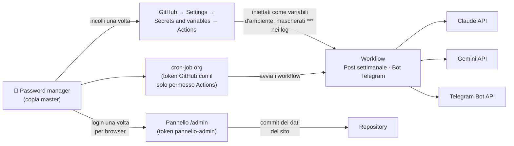
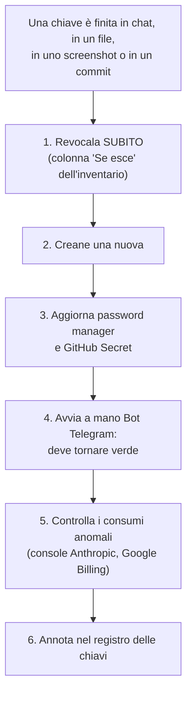

# Sicurezza, chiavi e token

[← Indice](README.md)

## Le 7 regole

1. **Una chiave non si scrive mai** in chat (Claude compreso), email, WhatsApp, Telegram, note condivise, screenshot o file del repository. Si conserva **solo** nel password manager e in **GitHub → Secrets**.
2. **Il repository è pubblico**: tutto quello che c'è dentro lo può leggere chiunque. Prima di ogni commit, `git status` non deve mostrare file come `.env`, `chiavi.txt` o `credentials.json`.
3. **2FA attiva** su GitHub, Anthropic, Google e Telegram. Su GitHub è obbligatoria: chi entra nell'account controlla il sito.
4. **Ogni chiave ha il minimo dei permessi** e, dove si può, **una scadenza e un limite di spesa**.
5. **Nel gruppo Telegram solo persone del team:** chiunque ci sia dentro può pubblicare sul sito con un tap e, dal radar eventi, **attivare un'offerta** (banner e sconto nel calcolatore) con ✅ *È libero: attiva l'offerta*.
6. **Se una chiave potrebbe essere uscita, si revoca subito**, senza aspettare di esserne certi. Rifarla costa 5 minuti.
7. **Ogni chiave nuova, revocata o rinnovata si annota** nell'[inventario](#inventario-dei-segreti) qui sotto, con la data. Si annotano dove si trova e la scadenza, **mai il valore**.

## Dove stanno le chiavi

GitHub non mostra mai più il valore di un Secret, nemmeno a chi l'ha inserito, e nei log lo sostituisce con `***`. Per cambiare un Secret: *Settings → Secrets and variables → Actions → nome del secret → Update*.

## Inventario dei segreti

| Nome | Cos'è | Dove si crea | Dove si conserva | Permessi / limiti | Scadenza | Se esce: come si revoca |
| --- | --- | --- | --- | --- | --- | --- |
| `TELEGRAM_BOT_TOKEN` | Chiave del bot | Telegram → @BotFather | password manager + GitHub Secret | controlla il bot (leggere e scrivere nei suoi gruppi) | nessuna | BotFather → `/revoke` → scegli il bot → nuovo token → aggiorna il Secret |
| `ANTHROPIC_API_KEY` | Chiave Claude | console.anthropic.com → API Keys (organizzazione *Mistralia srls*) | password manager + GitHub Secret | spende credito Anthropic → **impostare un limite mensile** in Settings → Limits | nessuna | Console → API Keys → *Disable/Delete* → nuova chiave → aggiorna il Secret |
| `GEMINI_API_KEY` | Chiave Gemini | aistudio.google.com → Get API key | password manager + GitHub Secret | spende sulla fatturazione Google → **budget con avviso** in Google Cloud → Billing; consigliato limitare la chiave alla sola *Generative Language API* | nessuna | AI Studio → API keys → elimina → nuova → aggiorna il Secret |
| `TELEGRAM_CHAT_ID` | Identificativo del gruppo (inizia con `-100`) | comando `/id` nel gruppo | GitHub Secret | non è una chiave: dice al bot qual è il gruppo "giusto" | — | se il gruppo cambia, rifai `/id` e aggiorna |
| Token GitHub `cron-job` | Permette a cron-job.org di avviare i workflow | GitHub → Developer settings → Fine-grained tokens | password manager + cron-job.org | **solo** Actions read/write **solo** su questo repository: non può modificare il sito né leggere i Secrets | **1 anno**: annotare la data e rinnovare prima | GitHub → Fine-grained tokens → *Revoke* → nuovo → aggiorna i 2 timer su cron-job.org |
| Token GitHub `pannello-admin` | Permette al pannello www.mistralia.co/admin di salvare le modifiche | GitHub → Developer settings → Fine-grained tokens | password manager + memoria del browser in cui fai il login al pannello | **Contents read/write solo** su questo repository: può modificare **qualunque file** del repository (non i Secrets, non le impostazioni) | **1 anno**: annotare la data e rinnovare prima | GitHub → Fine-grained tokens → *Revoke* → nuovo → rifai il login nel pannello |
| `GITHUB_TOKEN` | Token automatico dei workflow | lo crea GitHub a ogni giro | — | quelli scritti in `permissions:` di ogni workflow | scade a fine giro | — |

**Registro delle chiavi:** aggiungi una riga a ogni creazione, rinnovo o revoca.

| Data | Chiave | Azione | Chi |
| --- | --- | --- | --- |
| _da compilare_ | Token GitHub `pannello-admin` (Contents read/write, solo questo repository) | creato; **segnare qui la data di scadenza** | Gianluca |
| 2026-11-22 | Token GitHub `cron-job` (Actions read/write, solo questo repository) | creato e inserito su cron-job.org; **segnare qui la data di scadenza** | Gianluca |
| 2026-11-21 | `TELEGRAM_BOT_TOKEN`, `ANTHROPIC_API_KEY`, `GEMINI_API_KEY`, `TELEGRAM_CHAT_ID` | create e inserite nei Secrets | Gianluca |

## Le Variables non sono segreti

In *Settings → Secrets and variables → Actions → Variables* si mettono solo impostazioni **non riservate**, che nei log si vedono in chiaro:

| Variable | Uso |
| --- | --- |
| `ANTHROPIC_MODEL` | Facoltativa: sovrascrive il modello dei testi di `config.json` |
| `GEMINI_IMAGE_MODEL` | Facoltativa: sovrascrive il modello delle immagini |

Una Variable creata per errore tra i **Secrets** viene ignorata dal codice: `vars.X` e `secrets.X` sono cose diverse.

## Repository pubblico

Pubblico significa che **chiunque**, anche non loggato, può leggere:
- il codice, i prompt e le impostazioni;
- `automazione/bozze/`: **anche le bozze non pubblicate**, con testi e immagini;
- `automazione/stato.json`: id dei messaggi, temi proposti, chi ha pubblicato (il nome Telegram) e la spesa del mese;
- la storia di tutte le modifiche (*commit*) con l'autore.

**Non** può leggere: i Secrets, i log dei workflow con le chiavi (mascherate), il gruppo Telegram.

Il vantaggio è che GitHub Actions è gratuito senza limiti. Se un giorno serve riservatezza (bozze, spese), si può rendere il repository privato, ma con due conseguenze. Le Actions sono gratuite solo fino a 2.000 minuti al mese, e GitHub arrotonda ogni giro al minuto intero: con la sveglia ogni minuto il bot ne userebbe decine di migliaia, quindi un repository privato richiederebbe una sveglia molto più rada. In più, GitHub Pages su repository privati richiede un piano a pagamento.

## Chi ha accesso a cosa

**Gianluca è l'unico riferimento per tutti gli account e le chiavi.** Gli altri membri del team hanno accesso solo al gruppo Telegram.

| Accesso | Chi | Dove si gestisce |
| --- | --- | --- |
| Account GitHub `mistraliagianluca` (admin del repository) | Gianluca | github.com → Settings → Password and authentication |
| Collaboratori del repository (possono modificare il sito) | nessuno, per ora | repository → Settings → Collaborators |
| Gruppo Telegram "Mistralia" (può approvare, pubblicare e attivare offerte dal radar) | i membri del team | info del gruppo → Membri |
| Proprietario del bot (BotFather) | chi l'ha creato | Telegram → @BotFather |
| Console Anthropic | Gianluca | console.anthropic.com → Settings → Members |
| Google AI Studio / Cloud | Gianluca | console.cloud.google.com → IAM |
| Registrar del dominio `mistralia.co` | Gianluca | pannello del registrar |
| cron-job.org (sveglia del bot) | Gianluca | cron-job.org → account |

Quando qualcuno lascia il team: toglilo dal gruppo Telegram, dai collaboratori GitHub e dalle console. Se conosceva qualche chiave, **ruotala**.

**Il token del pannello resta nel browser.** Fai il login al pannello solo sui tuoi dispositivi. Su un computer non tuo, alla fine esci dal pannello (*Sign Out*). Se perdi il telefono o il computer, revoca il token.

## Cosa fare se una chiave è uscita

Se la chiave è finita in un **commit**, cancellare il file non basta: resta nella storia di git, che nel repository pubblico tutti possono leggere. Quello che conta è **revocarla**: una chiave revocata non vale più niente, anche se si legge.

## Controlli periodici (ogni 3 mesi)

- [ ] I consumi su console.anthropic.com e Google Billing sono coerenti con le bozze fatte.
- [ ] I limiti di spesa esterni sono ancora impostati.
- [ ] I membri del gruppo Telegram sono tutti del team.
- [ ] I collaboratori GitHub sono quelli giusti, e la 2FA è attiva.
- [ ] La scadenza del token `pannello-admin` è lontana più di un mese.
- [ ] La scadenza del token `cron-job` è lontana più di un mese (se scade, il bot smette di rispondere: cron-job.org mostrerà errori 401).
- [ ] `git log -p | grep -iE "sk-ant|AIza|[0-9]{8,}:[A-Za-z0-9_-]{30,}"` non trova chiavi nella storia del repository.
