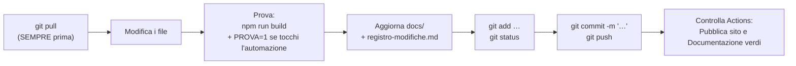

# Sviluppo: lavorare sul codice

[← Indice](README.md)

## Preparare il Mac (una volta sola)

```bash
# 1. Homebrew (se manca): https://brew.sh
brew install node git gh      # Node 22 o più recente
node -v                       # deve dire v22.x o superiore

# 2. Chi sei per git (compare nei commit, che sono pubblici)
git config --global user.name "Gianluca"
git config --global user.email "gianluca@mistralia.co"

# 3. Accesso a GitHub senza password
gh auth login                 # GitHub.com → HTTPS → Yes → Login with a web browser
gh auth status                # deve dire "Logged in"

# 4. Il repository (se non c'è già in ~/Documents/GitHub/)
gh repo clone mistraliagianluca/mistraliagianluca.github.io
cd mistraliagianluca.github.io
npm ci                        # installa Astro (crea node_modules/, escluso da git)
```

Ogni volta che apri il Terminale, entra nella cartella del repository: `cd ` seguito dalla cartella trascinata nel Terminale. Con `pwd` controlli dove sei: il percorso deve finire con `/mistraliagianluca.github.io`.

## Il giro di una modifica



```bash
git pull                                  # 1. prendi le modifiche del bot e del team
# … modifica …
npm run build                             # 2. deve finire con "Complete!"
git add -A                                # 3. prepara
git status                                # 4. LEGGI l'elenco: ci sono solo i file che volevi?
git commit -m "Cosa ho cambiato e perché"
git push
```

**Perché `git pull` prima di tutto:** il bot fa commit da solo (stato, bozze, articoli) ogni volta che lavora, e anche il pannello `/admin` fa commit quando salvi. Se non scarichi le sue modifiche, il tuo `push` viene rifiutato. Se succede, fai `git pull` e poi di nuovo `git push`.

## Caricare un aggiornamento ricevuto da Claude

Claude manda gli aggiornamenti come zip con **solo i file cambiati**, nella stessa struttura del repository.

```bash
git pull
# apri lo zip in Download; si crea una cartella (es. ~/Downloads/aggiornamento)
cp -R ~/Downloads/aggiornamento/. ./      # copia anche le cartelle nascoste come .github
git status                                # devono comparire SOLO i file annunciati
git add -A
git commit -m "Descrizione dell'aggiornamento"
git push
```

- **Prima** di aprire lo zip, cestina in Download la cartella dello zip precedente con lo stesso nome: altrimenti il Mac crea `aggiornamento 2` e rischi di copiare file vecchi.
- **Non** trascinare cartelle con il Finder dentro il repository: con "Sostituisci" cancella i file che ci sono solo nel repository, e i file nascosti come `.gitignore` e `.github` non vengono copiati.
- ⚠️ **Mai** `rsync --delete` o "sostituisci tutto" sulla cartella `automazione/`: cancelleresti `stato.json` e le bozze del bot.
- Se `git status` mostra file che non c'entrano, fermati e chiedi prima di fare commit.

## Test in modalità PROVA

Nessuna chiamata esce: costo zero.

```bash
# Una bozza finta
rm -f automazione/prova-telegram.log
PROVA=1 TELEGRAM_CHAT_ID=1 node automazione/genera.mjs
cat automazione/prova-telegram.log        # i messaggi che il bot avrebbe mandato

# Simulare un tap su "Pubblica" della bozza appena creata
C=$(node -p 'require("./automazione/stato.json").bozza.codice')
echo "[{\"update_id\":1,\"callback_query\":{\"id\":\"q\",\"from\":{\"first_name\":\"Test\"},\"data\":\"pub:$C\",\"message\":{\"chat\":{\"id\":1}}}}]" > automazione/prova-updates.json
PROVA=1 TELEGRAM_CHAT_ID=1 node automazione/telegram.mjs

# Simulare una risposta (correzione) alla bozza
M=$(node -p 'require("./automazione/stato.json").bozza.messageId')
echo "[{\"update_id\":2,\"message\":{\"message_id\":9,\"chat\":{\"id\":1},\"text\":\"più corto\",\"reply_to_message\":{\"message_id\":$M}}}]" > automazione/prova-updates.json
PROVA=1 TELEGRAM_CHAT_ID=1 node automazione/telegram.mjs
```

⚠️ I test **modificano davvero** `automazione/stato.json`, `automazione/bozze/` e, con Pubblica, `src/content/diario/`. Alla fine rimetti tutto com'era **prima** di fare commit:

```bash
git restore automazione/stato.json src/content/diario public/assets/diario
git clean -fd automazione/bozze src/content/diario public/assets/diario
```

## Provare il sito sul Mac

```bash
npm run dev          # apri http://localhost:4321 (Ctrl+C per fermare)
npm run build        # la stessa compilazione che fa GitHub: deve finire con "Complete!"
```

<a id="regola-documentazione"></a>
## Regola: la documentazione si aggiorna a ogni push

**Chi cambia codice o configurazione aggiorna, nello stesso commit:**

1. le pagine di `docs/` che descrivono quello che è cambiato;
2. il file [`docs/registro-modifiche.md`](registro-modifiche.md), aggiungendo **in cima** una riga con la data, cosa è cambiato, perché e cosa deve fare chi usa il sistema.

**Cosa conta come "codice o configurazione"** (e fa scattare il controllo): `.github/workflows/`, i file in `automazione/` (`.mjs`, `prompt.md`, `verifica.md`, `config.json`), `src/components/`, `src/layouts/`, `src/lib/`, `src/pages/`, `src/styles/`, `src/content.config.ts`, `astro.config.mjs`, `package.json`, `.gitignore`, `public/admin/` (configurazione del pannello).

**Non** fanno scattare il controllo: prezzi, promo, info, testi (`src/data/`, `src/i18n/`), foto, articoli del Diario e lo stato del bot, quindi nemmeno i salvataggi dal pannello.

**Cosa succede in automatico a ogni push** (workflow *Documentazione*):
- `docs/riferimento.md` viene **rigenerato** dai file veri: workflow, orari, segreti, impostazioni, prezzi, promo, articoli, struttura. Non va mai scritto a mano.
- Se il push cambia codice o configurazione ma **non** `docs/registro-modifiche.md`, il workflow diventa **rosso ❌** ed elenca i file da documentare. Il sito non si blocca, ma la ❌ resta finché un nuovo push non aggiunge il registro.

Il file `CLAUDE.md` nella cartella principale ripete queste regole per Claude e per qualunque assistente AI lavori sul progetto.

### Checklist prima di ogni push

- [ ] `git pull` fatto prima di iniziare
- [ ] `npm run build` finisce con `Complete!`
- [ ] Se hai toccato `automazione/`: provato con `PROVA=1` e ripulito
- [ ] `git status` mostra solo i file voluti: niente chiavi, niente `node_modules/`, niente `dist/`
- [ ] Pagine di `docs/` aggiornate e riga aggiunta in `docs/registro-modifiche.md`
- [ ] Dopo il push: **Pubblica sito** e **Documentazione** verdi in Actions

## Tornare indietro

Ogni modifica è un commit, quindi si può annullare:

```bash
git log --oneline -10            # trova il commit da annullare (es. a1b2c3d)
git revert a1b2c3d               # crea un commit che lo annulla
git push
```

Dal sito di GitHub, per un file solo: apri il file → **History** → scegli la versione buona → copia il contenuto → modifica con la matita e incolla.

<a id="togliere-un-articolo"></a>
## Togliere un articolo dal Diario

**Il modo più semplice è il pannello:** www.mistralia.co/admin → *Diario di bordo* → apri l'articolo (file `it` ed `en`) → interruttore **Nascondi dal sito** oppure **Delete**. Vedi [Il sito → Articoli scaduti e nascosti](03-sito.md#articoli-scaduti-e-nascosti). Da riga di comando:

```bash
git pull
ls src/content/diario/           # trova la chiave, es. matera-natale-sassi-presepe-vivente-camper
K=matera-natale-sassi-presepe-vivente-camper
git rm src/content/diario/$K.it.md src/content/diario/$K.en.md public/assets/diario/$K.jpg
git commit -m "Tolto l'articolo $K"
git push
```

Dopo circa 2 minuti l'articolo non c'è più sul sito. La bozza resta in `automazione/bozze/` come archivio.

## Avviare un workflow a mano

GitHub → **Actions** → scegli il workflow a sinistra → **Run workflow** (pulsante verde) → **Run workflow**.
Usa **Run workflow**, non **Re-run** su un giro vecchio: il re-run riusa la versione del codice di allora.

## Cosa non fare

| Non fare | Perché |
| --- | --- |
| Modificare a mano `automazione/stato.json` | Il bot rileggerebbe vecchi messaggi o perderebbe la bozza attiva |
| Scrivere a mano `docs/riferimento.md` | Viene riscritto a ogni push |
| Modificare a mano i file `*.en.md` del Diario | Il bot li riscrive dall'italiano a ogni modifica |
| Mettere chiavi in un file del repository | È pubblico. Vedi [Sicurezza](05-sicurezza.md) |
| Committare `node_modules/`, `dist/`, `.astro/` | Sono generati; `.gitignore` li esclude, non toglierlo |
| Cancellare `public/CNAME` | Il sito perde il dominio www.mistralia.co |
| Premere più volte Rigenera o lanciare tanti `/nuovo` per prova | Ogni bozza costa; per provare c'è `PROVA=1` |
