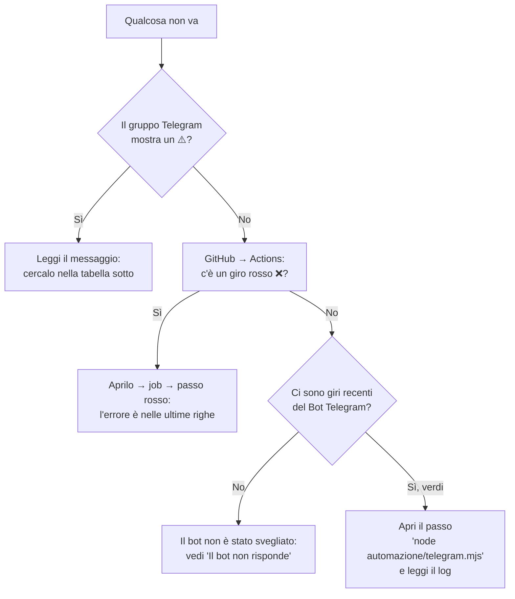

# Problemi e soluzioni

[← Indice](README.md)

## Dove guardare per primo

## Errori già incontrati

| Messaggio / sintomo | Causa | Soluzione |
| --- | --- | --- |
| **Il bot non risponde** e in Actions non ci sono giri recenti | La sveglia cron-job.org non chiama GitHub | Apri la cronologia su cron-job.org: **401/403** = token GitHub scaduto o revocato (rifallo, vedi [Sicurezza](05-sicurezza.md)); **404** = URL sbagliato; job disattivato = riattivalo. Subito: Actions → *Bot Telegram* → **Run workflow** |
| Molti giri grigi *cancelled* con *"Canceling since a higher priority waiting request for automazione exists"* | Sveglia ogni minuto: GitHub tiene un solo giro in attesa e cancella i precedenti | Normale, non si perde nessun messaggio. Vedi [Automazione](04-automazione.md#giri-cancelled-in-actions-è-normale) |
| Il lunedì la bozza non arriva | Errore durante la preparazione (il bot l'ha scritto nel gruppo) oppure questa settimana c'era già una bozza | Leggi il ⚠️ nel gruppo e scrivi `/nuovo` |
| `not_found_error … model: claude-…` | Il modello è stato dismesso da Anthropic | Aggiorna `modelloTesti` in `automazione/config.json` con un modello attuale. Se esiste la Variable `ANTHROPIC_MODEL`, aggiorna o cancella anche quella |
| Cambiato il modello ma usa ancora quello vecchio | La Variable è stata creata tra i **Secrets** o in un *Environment*, oppure hai usato **Re-run** | Deve stare in *Variables* del repository; usa **Run workflow** |
| `Gemini: 429 … free_tier … limit: 0` | La generazione di immagini non è gratuita: manca la fatturazione | aistudio.google.com → la chiave → **Set up billing**; attendi 5–10 minuti e riprova |
| `Telegram sendPhoto: Bad Request: BUTTON_DATA_INVALID` | Dati del pulsante oltre 64 byte | Risolto il 21/11/2026 (codice corto nei pulsanti). Se ricompare, è un bug: avvisa chi sviluppa |
| `answerCallbackQuery … query is too old` | Telegram accetta la conferma del tap solo per pochi secondi | Risolto il 21/11/2026: la conferma scaduta viene ignorata |
| `Unauthorized` da Telegram | `TELEGRAM_BOT_TOKEN` sbagliato o revocato | Ricopia il token da @BotFather nel Secret |
| `/id` non riceve risposta, giro verde | Privacy del bot attiva: nei gruppi il bot non vede i messaggi | @BotFather → `/setprivacy` → bot → **Disable**; togli e riaggiungi il bot al gruppo |
| Bozza con ⚠️ *VERIFICA NON SUPERATA* | Il verificatore non ha confermato evento, date o traghetto | Non pubblicare: 🔄 Rigenera oppure rispondi *"togli l'evento, parla solo del luogo"* |
| Rigenera ripropone lo stesso tema | Prima del 21/11/2026 Claude riceveva solo un elenco generico di temi | Risolto: ora riceve la bozza scartata e deve cambiare evento e luogo |
| *budget del mese raggiunto* | La spesa stimata del mese ha superato `budgetMensileDollari` | Aspetta il mese successivo o alza il valore in `config.json` (con una riga nel registro) |
| Spesa Claude molto più alta del previsto | Ricerche web lunghe, troppi tentativi, modello costoso | Controlla console.anthropic.com → Usage; riduci `ricercheScrittura`, `ricercheVerifica`, `tentativiVerifica`; usa Sonnet. Vedi [Costi](04-automazione.md#costi-e-tetto-di-spesa) |
| Il testo della bozza si interrompe a metà ("Per cor…") | Didascalia della foto oltre i 1024 caratteri | Risolto il 21/11/2026: il testo lungo arriva in un messaggio separato |
| Il pannello `/admin` non accetta il token o non salva (*401*, *403*, *Bad credentials*) | Token scaduto, revocato o senza *Contents: Read and write* su questo repository | Rifai il token (vedi [Il sito → pannello](03-sito.md#il-pannello-wwwmistraliacoadmin)), poi *Sign Out* e di nuovo *Sign In Using Access Token* |
| Il pannello dice che il file è cambiato nel frattempo | Qualcuno (tu dal Mac o dall'editor web) ha modificato lo stesso file | Ricarica la pagina del pannello e rifai la modifica |
| Pagina `/admin` bianca | unpkg.com non raggiungibile o bloccato dal browser | Riprova più tardi; nel frattempo usa l'editor web di GitHub |
| **Pubblica sito** rosso dopo una modifica a un `.json` | Errore di formato (virgola, virgolette, parentesi) | Il sito online resta com'era. Apri il file su GitHub: l'errore indica la riga. Correggi o annulla la modifica |
| **Documentazione** rossa ❌ | Push con modifiche al codice senza una riga in `docs/registro-modifiche.md` | Aggiungi la riga (e aggiorna le pagine di `docs/`), poi un nuovo push |
| `git push` rifiutato (*rejected… fetch first*) | Il bot ha fatto commit nel frattempo | `git pull`, poi `git push` |
| `git status` mostra `node_modules/` o `dist/` | Manca o è incompleto `.gitignore` (il Finder non copia i file nascosti) | Ripristina `.gitignore` (vedi `docs/riferimento.md` → struttura) e `git rm -r --cached node_modules dist .astro` |
| Il sito ha perso il dominio | Cancellato `public/CNAME` o cambiato in Settings → Pages | Ripristina `public/CNAME` con `www.mistralia.co` e controlla Settings → Pages |
| *"⚠️ Non sono riuscito ad aggiornare la versione inglese di …"* | Errore di Claude (credito, modello, rete) durante la traduzione | Il bot non riprova da solo: sistema la causa e rimodifica l'articolo italiano (basta una virgola) per far ripartire la traduzione |
| La versione inglese di un articolo ha perso una mia correzione | È stata modificata a mano: l'inglese viene riscritto a ogni modifica dell'italiano | Correggi l'italiano; se serve una frase precisa in inglese, chiedi di aggiungerla al prompt di traduzione in `traduzioni.mjs` |
| Il banner della promo non compare | `attiva: false`, data di oggi fuori da *Banner visibile dal/fino al*, oppure *Pubblica sito* non è ancora finito dopo il Save | Controlla la promo nel pannello e il giro di *Pubblica sito* in Actions; ricarica la pagina con Cmd+Shift+R. Prima del 22/11/2026 c'era anche un bug con le date salvate dal pannello, ora corretto |

## Prima di chiedere aiuto, raccogli:

1. Il messaggio ⚠️ di Telegram, copiato per intero.
2. Il link al giro di Actions (rosso o sospetto).
3. Cosa stavi facendo e a che ora.

**Mai** incollare chiavi o token, anche se compaiono in un errore: nei log di GitHub sono già mascherati con `***`.
