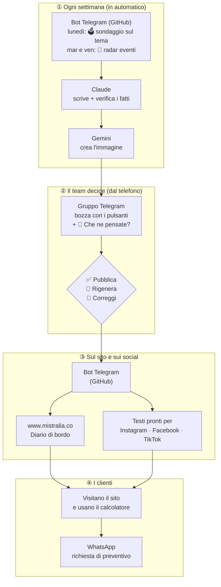

# Documentazione di Mistralia digitale

Questa cartella spiega **tutto** il sistema digitale di Mistralia: il sito www.mistralia.co, il post settimanale automatico, il bot Telegram, gli account, le chiavi e cosa fare quando qualcosa non va.

> 📌 **Regola del progetto:** la documentazione fa parte del codice. Chi cambia codice o configurazione aggiorna nello stesso push le pagine qui sotto e aggiunge una riga al [registro delle modifiche](registro-modifiche.md). Se se ne dimentica, il workflow *Documentazione* segna una ❌ rossa in GitHub Actions. Dettagli in [Sviluppo](06-sviluppo.md#regola-documentazione).

## Da dove comincio?

| Sei… | Leggi | Tempo |
| --- | --- | --- |
| **Nel gruppo Telegram** e devi approvare i post | [Uso quotidiano](02-uso-quotidiano.md) | 10 min |
| Chi deve **cambiare prezzi, stagioni, promo, foto o contatti** (dal pannello www.mistralia.co/admin) | [Il sito](03-sito.md) | 15 min |
| Chi deve capire **come è fatto** il sistema | [Architettura](01-architettura.md) | 15 min |
| Chi gestisce **account, chiavi e accessi** | [Sicurezza, chiavi e token](05-sicurezza.md) | 15 min |
| Chi **modifica il codice** o carica aggiornamenti | [Sviluppo](06-sviluppo.md) | 20 min |
| Chiunque, **quando qualcosa non funziona** | [Problemi e soluzioni](07-problemi.md) | — |

## Tutte le pagine

1. [Architettura](01-architettura.md): i pezzi del sistema, dove stanno, come si parlano, quanto costano
2. [Uso quotidiano](02-uso-quotidiano.md): il bot Telegram, i comandi, il flusso settimanale, la pubblicazione sui social
3. [Il sito](03-sito.md): cosa si modifica e dove, prezzi, promo, calendario, foto, calcolatore
4. [Automazione](04-automazione.md): come nasce una bozza, la verifica dei fatti, lo stato del bot, i costi, la sveglia
5. [Sicurezza, chiavi e token](05-sicurezza.md): inventario dei segreti, regole, cosa fare se una chiave esce
6. [Sviluppo](06-sviluppo.md): il Mac, git, i test, come caricare aggiornamenti, la regola sulla documentazione
7. [Problemi e soluzioni](07-problemi.md): errori già visti e come si risolvono
8. [Riferimento tecnico](riferimento.md): **generato automaticamente** dai file veri (workflow, orari, segreti, impostazioni, prezzi)
9. [Registro delle modifiche](registro-modifiche.md): cosa è cambiato, quando e perché

## Il sistema in una figura

**In una frase:** ogni lunedì dalle 9 il bot, che gira su GitHub ed è svegliato ogni minuto da cron-job.org, fa votare al team il tema della settimana con un sondaggio (il martedì e il venerdì propone anche eventi dal radar, eventualmente con un'offerta da attivare sul sito), chiede a Claude un post sul tema scelto, ne fa verificare i fatti da una seconda chiamata a Claude, fa creare l'immagine a Gemini e manda la bozza nel gruppo Telegram. Il team la approva con un tap, l'articolo finisce sul sito e il bot manda i testi pronti per i social. I clienti vedono il sito e chiedono il preventivo su WhatsApp.

## Chi è il riferimento

**Gianluca** è l'unico riferimento tecnico e amministrativo per tutto: GitHub, chiavi, account AI, Telegram (proprietario del bot), cron-job.org e dominio `mistralia.co`.

## Glossario minimo

| Parola | Significato |
| --- | --- |
| **Repository** (o *repo*) | La cartella del progetto su GitHub: contiene codice, testi, prezzi, foto, articoli e lo stato del bot. Indirizzo: `github.com/mistraliagianluca/mistraliagianluca.github.io` |
| **Push** | Caricare su GitHub le modifiche fatte sul proprio computer |
| **Workflow** / **Actions** | Programmi che GitHub esegue da solo (a orario o dopo un push). Si vedono nella scheda **Actions** del repository |
| **Secret** | Una chiave riservata salvata su GitHub, che i workflow usano senza mostrarla |
| **Bozza** | La proposta di post che arriva su Telegram e aspetta un ✅ Pubblica |
| **Diario di bordo** | La sezione del sito con gli articoli pubblicati (in inglese *Journal*) |
| **Sveglia** | cron-job.org: chiama GitHub ogni minuto per avviare il bot |
| **Build** | La "compilazione" che trasforma i file del repository nelle pagine del sito |
